# OBDio

Lettore diagnostico OBD-II/EOBD per Windows 11 x64, pensato per adattatori
ELM327 Bluetooth come il Carista. Funziona in locale: nessun account,
nessun abbonamento, nessun servizio cloud. Gli unici collegamenti in rete
sono il controllo degli aggiornamenti su GitHub, che si può spegnere e non
invia nulla su di te o sul veicolo (vedi [Aggiornamenti](#aggiornamenti)), e
MQTT e il server MCP, solo se li attivi tu.

**L'app lavora in lettura, con una sola eccezione.** Legge codici guasto,
fermo immagine, monitor e dati in tempo reale. L'unica azione che modifica la
centralina è **Cancella codici guasto** (servizio OBD 04), che va confermata
esplicitamente: vedi [Cancellare i codici guasto](#cancellare-i-codici-guasto).
Non scrive sulle centraline, non esegue codifiche né test attuatori e non
permette di inviare comandi liberi.

**Scarica**: l'ultima versione è nella pagina dei
[rilasci su GitHub](https://github.com/inalto/OBDio/releases/latest)
(file `OBDio-<versione>-windows-x64.zip`). Licenza: [MIT](LICENSE).

Versione 1.0.1. Primo caso d'uso: Peugeot 208 1.2 benzina 82 CV (motore HMZ)
con codice P0420. Le novità rispetto alla prima versione, fase per fase, sono
in [docs/NOVITA.md](docs/NOVITA.md).

> **Stato delle verifiche.** Tutto il flusso è stato verificato in modalità
> demo e con test automatici. **Non è ancora stato provato su un adattatore
> Carista né sull'auto, né con un broker MQTT o Home Assistant reali, né con un
> registro Torque reale, né su un telefono**: vedi
> [Stato delle verifiche](#stato-delle-verifiche) e
> [Controlli da fare sull'auto](#controlli-da-fare-sullauto).

## Indice

- [Avvio](#avvio), [Navigazione](#navigazione), [Provare la demo](#provare-la-demo)
- [Collegare l'adattatore](#collegare-ladattatore)
- [Pagina Sensori](#pagina-sensori), [Cruscotto](#cruscotto)
- [Acquisire una sessione P0420](#acquisire-una-sessione-p0420)
- [Recuperare il CSV e riaprire le sessioni](#recuperare-il-csv-e-riaprire-le-sessioni)
- [Importare ed esportare le sessioni](#importare-ed-esportare-le-sessioni)
- [Rivivere una sessione (riproduzione)](#rivivere-una-sessione-riproduzione)
- [Cosa mostra la diagnosi](#cosa-mostra-la-diagnosi), [Cancellare i codici guasto](#cancellare-i-codici-guasto)
- [MQTT](#mqtt), [Server MCP per assistenti AI](#server-mcp-per-assistenti-ai), [Aggiornamenti](#aggiornamenti), [Android](#android)
- [Stato delle verifiche](#stato-delle-verifiche), [Controlli da fare sull'auto](#controlli-da-fare-sullauto)
- [Limiti noti](#limiti-noti), [Comandi inviati](#comandi-inviati), [Compilare dai sorgenti](#compilare-dai-sorgenti)
- Se qualcosa non va: [docs/DIAGNOSI_PROBLEMI.md](docs/DIAGNOSI_PROBLEMI.md) (registri, diagnosi Bluetooth, errori frequenti)

## Avvio

Il pacchetto è portabile: copia la cartella dove preferisci e avvia
`OBDio.exe`. Non serve installare nulla. Le sessioni vengono salvate nella
sottocartella `sessioni` accanto all'eseguibile (se la cartella non è
scrivibile, in `Documenti\OBDio\sessioni`).

L'eseguibile non è firmato: al primo avvio Windows SmartScreen può mostrare un
avviso («Ulteriori informazioni» → «Esegui comunque»).

## Navigazione

L'app ha sei pagine, sempre le stesse: **Connessione**, **Diagnosi**,
**Cruscotto**, **Sensori**, **Sessioni**, **Impostazioni**.

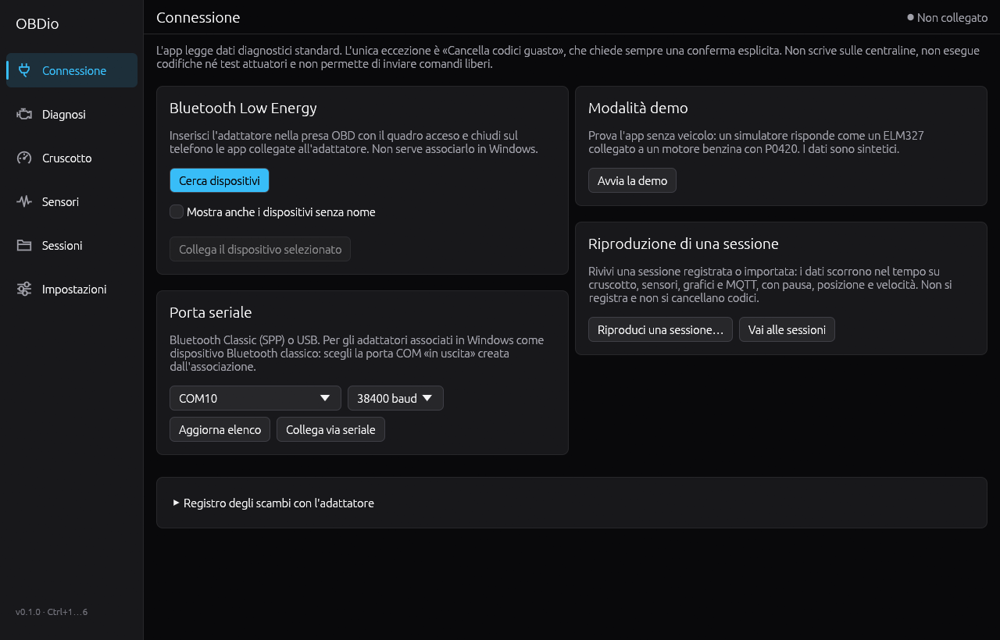

- **Finestra larga** (da 900 px in su): a sinistra la barra con icona e nome
  di ogni pagina; quella aperta è evidenziata in azzurro.
- **Finestra stretta** (sotto i 900 px, come un telefono): la barra scende in
  basso, con icone e nomi brevi (*Collega*, *Diagnosi*, *Cruscotto*,
  *Sensori*, *Sessioni*, *Opzioni*), il contenuto va su una colonna sola e
  pulsanti, campi e righe toccabili sono alti almeno 44 px. La finestra si
  può restringere fino a 360 × 560 px.
- In alto, su ogni pagina, la **barra di stato**: nome della pagina, stato del
  collegamento, registrazione in corso con la durata e, se attiva, la
  pubblicazione MQTT. Sotto compaiono la fascia arancione della demo o della
  riproduzione, la barra di trasporto e gli eventuali errori.

| Tasti | Azione |
|---|---|
| Ctrl+1 … Ctrl+6 | Apre la pagina corrispondente, nell'ordine della barra |
| Esc | Chiude la finestra aperta (conferma, scelta del file, anteprima) |

Chiudendo l'app con modifiche al cruscotto non salvate compare la domanda
**Salva / Non salvare / Annulla**.

| Diagnosi su telefono | Cruscotto su telefono | Sensori su telefono |
|---|---|---|
| 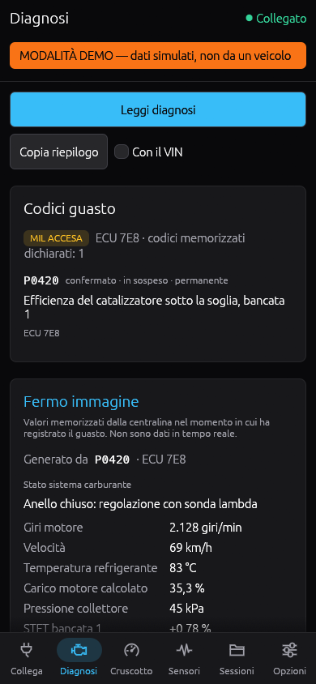 | 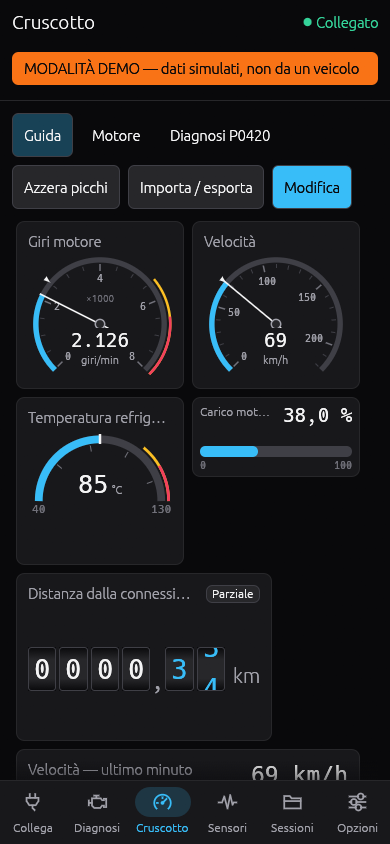 | 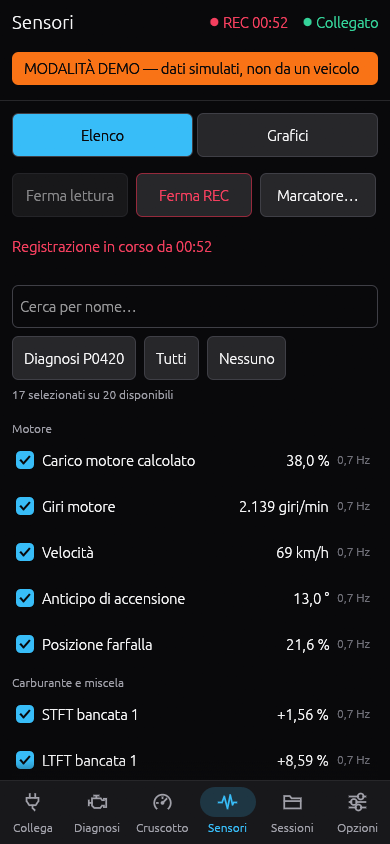 |

Sul layout stretto:

- **Diagnosi**: i codici diventano schede (codice e stati su una riga, la
  descrizione sotto), il fermo immagine una lista etichetta/valore;
  *Cancella codici guasto…* sta in fondo alla pagina, in un riquadro rosso
  separato da *Leggi diagnosi*.
- **Sensori**: un selettore **Elenco | Grafici** sceglie che cosa vedere;
  lettura, registrazione e marcatori sono in una striscia di tre pulsanti
  visibile in entrambi i casi. Un grafico per riga.
- **Sessioni**: prima l'elenco, poi il dettaglio con **Tutte le sessioni**
  per tornare indietro.
- **Cruscotto**: griglia a 4 colonne e ispettore dal basso (vedi
  [Personalizzare](#personalizzare)).

## Provare la demo

1. Scheda **Connessione** → **Avvia la demo**.
2. Scheda **Diagnosi** → **Leggi diagnosi**: compare
   P0420 con il fermo immagine a 69 km/h, 2.128 giri/min, 83 °C, STFT +0,78 %,
   LTFT +8,59 %.
3. Scheda **Sensori** → **Avvia lettura**, poi **Registra**.
   Prova anche **Un grafico per sensore**, **Tutti** e il campo di ricerca.

In demo una fascia arancione **MODALITÀ DEMO** resta sempre visibile e ogni
curva porta la dicitura «(sintetico)». Tutti i valori sono generati da un
simulatore, segnali delle sonde lambda compresi: non descrivono un veicolo
reale. Il simulatore produce testo ELM327 grezzo, quindi i dati passano dallo
stesso decoder usato con l'adattatore vero. Ogni minuto simula 2,5 secondi di
mancata risposta della sonda a valle, per mostrare come appaiono i buchi.

## Collegare l'adattatore

Inserisci l'adattatore nella presa OBD, porta il quadro su ON (o avvia il
motore) e chiudi sul telefono le app collegate all'adattatore: un adattatore
già connesso al telefono non è raggiungibile dal PC.

### Bluetooth Low Energy (prima scelta)

1. Scheda **Connessione** → **Cerca dispositivi**. Di norma non serve
   associare l'adattatore in Windows; se però l'app dice che l'adattatore
   rifiuta l'accesso Bluetooth, associalo e riprova (o usa la porta seriale).
2. Seleziona l'adattatore nell'elenco (i probabili adattatori OBD sono
   marcati `[OBD]` e stanno in cima) → **Collega il dispositivo selezionato**.
3. L'app scopre i servizi GATT e apre il canale dati **solo** se corrispondono
   a uno dei profili seriali documentati (vedi sotto). Altrimenti mostra
   «Profilo BLE sconosciuto» con nome e UUID del dispositivo, senza scrivere
   nulla: usa **Copia elenco UUID** e conserva il testo.

### Porta seriale (Bluetooth Classic/SPP)

Per gli adattatori che Windows associa come dispositivo Bluetooth classico:

1. Associa l'adattatore da *Impostazioni → Bluetooth e dispositivi*.
2. In *Altre impostazioni Bluetooth → Porte COM* individua la porta **in
   uscita** associata all'adattatore.
3. In OBDio scegli quella porta COM → **Collega via seriale**. La velocità
   (baud) è irrilevante per le porte Bluetooth virtuali; 38400 va bene.

### Messaggi di errore

| Messaggio | Significato |
|---|---|
| Bluetooth disattivato | La radio Bluetooth di Windows è spenta. |
| Nessun adattatore Bluetooth nel PC | Windows non segnala alcuna radio. |
| Adattatore non raggiungibile | Il collegamento radio (o l'apertura della porta COM) non riesce: adattatore non alimentato, fuori portata o occupato dal telefono. |
| Profilo BLE sconosciuto | Collegato, ma i servizi GATT non sono fra quelli documentati. Nessuna scrittura eseguita. |
| L'adattatore non risponde ai comandi | Il canale è aperto ma il dispositivo non risponde come un ELM327. |
| La centralina non risponde | L'adattatore funziona, ma nessuna centralina risponde: quadro spento o protocollo non trovato. |
| Collegamento interrotto | Il collegamento è caduto. Il polling si ferma; la registrazione in corso viene chiusa e conservata. |
| L'adattatore rifiuta l'accesso Bluetooth | Il dispositivo risponde ma nega i servizi GATT (accesso negato o errore di protocollo): di solito vuole l'associazione in Windows. In alternativa, porta seriale (COM). |
| Errore interno | Un errore nel programma durante l'operazione indicata: il collegamento è chiuso, l'app resta aperta e si può riprovare. Dettagli nel registro degli errori. |

Gli errori di collegamento Bluetooth dicono anche **quale passo** non è
riuscito (connessione radio, scoperta dei servizi GATT, flusso o attivazione
delle notifiche); la connessione radio viene ritentata una volta da sola dopo
un errore transitorio.

Il **Registro degli scambi con l'adattatore**, in fondo alla scheda
Connessione, mostra comandi e risposte e i passi del collegamento Bluetooth
(righe `BLE`), ed è copiabile. La risposta al VIN non viene mai registrata.

Se l'app si chiude da sola o non si collega, i file da inviare (registro degli
errori e registro dei collegamenti) e la diagnosi Bluetooth da terminale
(`OBDio.exe --diagnosi-ble`) sono spiegati in
[docs/DIAGNOSI_PROBLEMI.md](docs/DIAGNOSI_PROBLEMI.md).

## Pagina Sensori

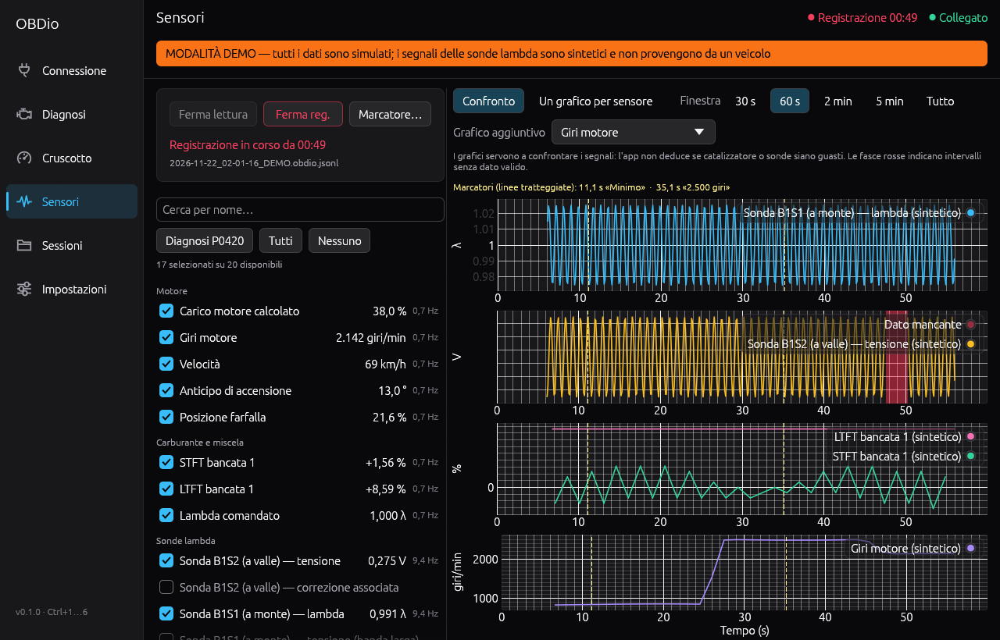

La scheda **Sensori** elenca **tutti** i parametri del catalogo che la
centralina dichiara di supportare, raggruppati in Motore, Carburante e
miscela, Sonde lambda, Temperature e pressioni, Distanze e tempi, Altro.

- **Ricerca** per nome, e selezioni rapide: **Diagnosi P0420** (sonde, STFT,
  LTFT, giri, velocità, temperatura), **Tutti**, **Nessuno**.
- La **spunta** accanto a un sensore lo mette nella lettura; se la lettura è
  già attiva, cambiare la selezione la aggiorna subito. Per ogni sensore
  spuntato l'elenco mostra il valore con l'unità (o lo stato della lettura, per
  esempio «Risposta mancante», mai zero) e la frequenza effettiva in Hz.
- A destra due viste. **Confronto**: i grafici impilati delle sonde, delle
  correzioni carburante e di un parametro aggiuntivo, con asse del tempo
  condiviso. **Un grafico per sensore**: una scheda per ogni sensore spuntato,
  con valore grande, **minimo, medio e massimo** dall'inizio della
  connessione, Hz e un piccolo grafico con le stesse fasce rosse (dato
  mancante), gli stessi marcatori e la stessa finestra temporale; le schede si
  dispongono in colonne secondo la larghezza della finestra.
  **Azzera min/max** riparte da zero con le statistiche.
- Senza collegamento l'elenco mostra i parametri presenti nei dati già letti.
- Sopra l'elenco ci sono tre pulsanti: **Avvia lettura** (o *Ferma
  lettura*), **Registra** (o *Ferma reg.*) e **Marcatore…**, che apre i
  marcatori rapidi e un campo per scriverne uno; sotto, la durata della
  registrazione in corso o l'ultima sessione salvata.

I grafici servono a confrontare i segnali: l'app non deduce se catalizzatore o
sonde siano guasti.

### Parametri aggiunti

Contachilometri (PID A6), distanza e tempo dalla cancellazione dei codici
(31, 4E), avviamenti a caldo dalla cancellazione (30), tempo con MIL accesa
(4D), pressione carburante (0A) e del rail (23), posizione della farfalla (45,
47, 4C), del pedale dell'acceleratore (49, 4A, 5A), coppia richiesta, effettiva
e di riferimento (61–63) e consumo istantaneo (5E). Tipo di carburante (51) e
norma OBD (1C) sono testi: si leggono una volta con la diagnosi e compaiono
nella pagina dei codici guasto e nel riepilogo. Le formule vengono da
Wikipedia, «OBD-II PIDs»; quelle dei PID 49, 4A e 4C sono dedotte da righe
accorpate della tabella e non verificate.

### Distanza parziale

Il **contachilometri** (PID A6) è obbligatorio solo dal modello 2019: molte
auto non rispondono. Per questo l'app calcola la **distanza parziale**: integra
la velocità della centralina principale nel tempo (regola del trapezio) a
partire dalla connessione. Se fra due letture della velocità passano più di 5
secondi, quel tratto non viene conteggiato, e una lettura mancante non aggiunge
nulla. È una stima, più precisa con una lettura frequente della velocità;
selezionarla fa leggere la velocità in automatico. Il valore viene registrato
come ogni altro sensore (chiave `distanza_parziale`, in km).

## Cruscotto

La scheda **Cruscotto** mostra pagine di strumenti disegnati dall'app, uno per
parametro, leggibili da un metro. Al primo avvio ci sono tre pagine pronte:

- **Guida**: giri, velocità, temperatura del refrigerante, carico,
  contachilometri (o distanza parziale) e l'andamento della velocità;
- **Motore**: pressione del collettore, anticipo, temperature di
  refrigerante, aria e olio, tensione del modulo, farfalla;
- **Diagnosi P0420**: sonda a monte e a valle (grafico e valore), STFT, LTFT,
  giri, spia MIL e registrazione. Le sonde si scelgono da sole fra lambda e
  tensione secondo quello che la centralina espone.

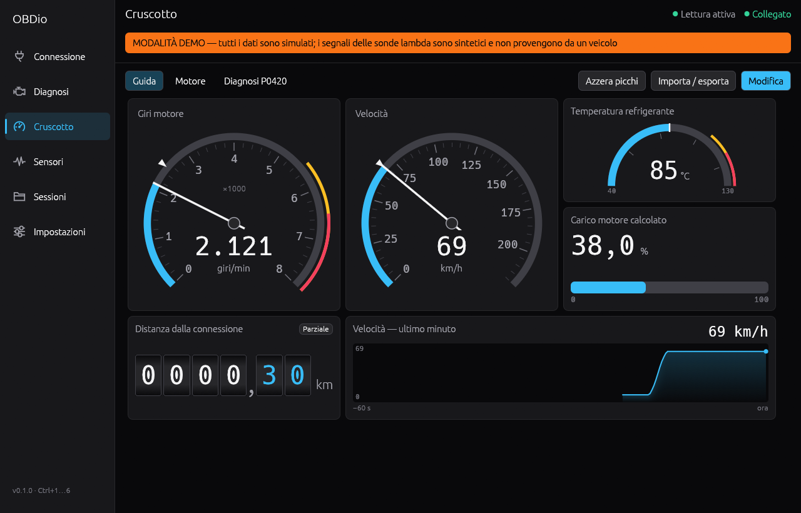

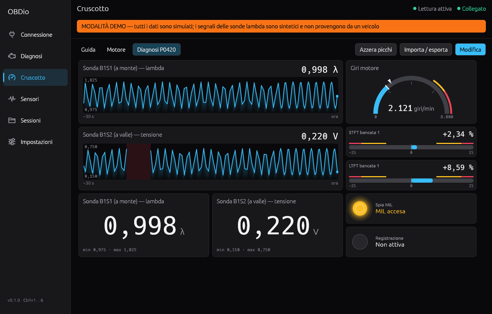

Aprendo il cruscotto da collegati, la **lettura parte da sola** con i
parametri della pagina visibile (più quelli spuntati in Sensori). Tornando a
un'altra scheda si torna alla selezione di Sensori; se la lettura era partita
solo per il cruscotto e non si sta registrando, si ferma.

### Tipi di strumento

| Tipo | Che cosa mostra |
|---|---|
| Quadrante | Scala a 270° con tacche «tonde», lancetta smorzata, valore grande, zone di attenzione e critiche, marcatore di picco |
| Arco | Come il quadrante ma a 180°, per riquadri bassi |
| Barra | Orizzontale o verticale secondo la forma; con zero al centro per i valori con segno (correzioni carburante) |
| Numerico | Valore grande con unità, minimo e massimo dalla connessione |
| Grafico | Gli ultimi N secondi dello stesso parametro; i tratti senza dato sono interrotti e segnati in rosso |
| Contachilometri | Cifre «a rulli»: il contachilometri della centralina (PID A6) se lo espone, altrimenti la distanza parziale calcolata, indicata da «Parziale» |
| Spia | Accesa o spenta, sempre con il testo: MIL dell'ultima diagnosi, registrazione in corso, o soglia superata da un parametro |

Un dato assente non diventa mai zero: lo strumento mostra «—» senza lancetta e
scrive il motivo. *In attesa del dato* prima del primo campione; *fermo da N s*
(valore e lancetta in grigio) se non arrivano campioni da più di 3 secondi; *La
centralina non risponde* o *Errore di comunicazione* se l'ultima lettura è
fallita; *Non supportato da questa centralina* (strumento attenuato) se la
centralina non dichiara il parametro. Quando il valore supera una soglia, il
numero e l'arco prendono il colore della zona (ambra o rosso). **Azzera
picchi** riparte da zero con i marcatori di picco senza toccare minimo e
massimo della pagina Sensori.

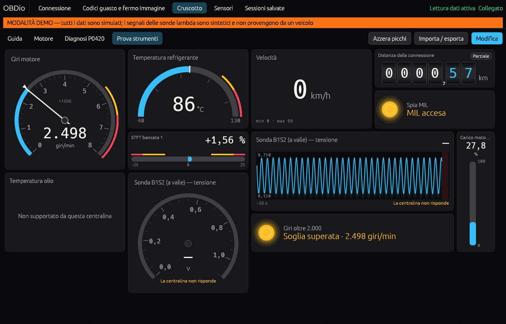

### Personalizzare

Il pulsante **Modifica** apre il modo di modifica: compaiono la griglia
punteggiata (12 colonne) e la barra *Modifica del cruscotto* con **Aggiungi
strumento**, **Salva** e **Annulla**.

- Trascinare uno strumento lo sposta (aggancio alla griglia); la maniglia
  nell'angolo in basso a destra lo ridimensiona. Se il posto è occupato il
  rettangolo diventa rosso e al rilascio lo strumento torna dov'era.
- Un clic seleziona lo strumento e apre l'**ispettore** a destra: parametro
  (con ricerca, prima quelli supportati), tipo, titolo, minimo e massimo,
  soglia di attenzione e critica con il verso (*sopra*, *sotto* o *fuori da
  ±*, simmetrica attorno a zero), decimali, marcatore di picco, durata del
  grafico, posizione e misura con pulsanti «−»/«+». Scegliendo un parametro,
  scala e soglie prendono valori sensati (giri 0–8.000 con zona rossa oltre
  6.500; temperatura 40–130 °C; correzioni ±25 % con soglie ±10 e ±20;
  tensione 10–16 V con allarme sotto 12 e 11 V; pressione del collettore
  0–255 kPa, da restringere a 0–105 per un motore aspirato).
  **Ripristina predefiniti**, **Duplica** ed **Elimina** sono in fondo.
- Nella riga delle schede: **Nuova pagina**, **Rinomina**, **Elimina pagina**.
- **Annulla** riporta tutto all'ultimo salvataggio: per questo aggiungere,
  spostare ed eliminare non chiedono conferma. Le modifiche non salvate sono
  segnalate e restano in memoria anche cambiando scheda.

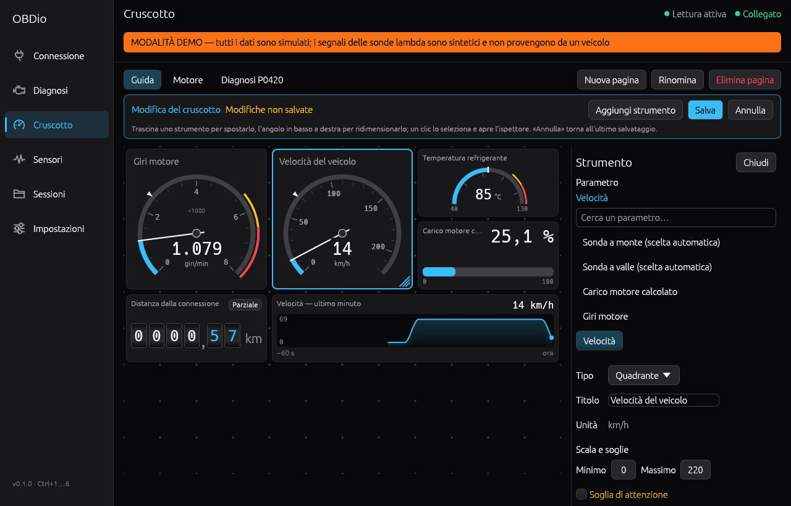

Sotto i 900 px di larghezza la pagina usa 4 colonne (gli strumenti si
ricompongono in ordine di lettura, in proporzione) e l'ispettore sale dal
basso; in questo layout posizione e misura si cambiano dall'ispettore e si
riferiscono alla griglia a 12 colonne.

### Importare ed esportare i cruscotti

Dal menu **Importa / esporta** si salva in JSON la pagina visibile o l'intero
insieme, e si importa un file esportato (una pagina o tutto): le pagine
importate si aggiungono alle esistenti e restano da salvare. Un file non
valido viene rifiutato con il motivo, senza cambiare nulla. La finestra
apre la finestra di sistema per scegliere il file da importare o dove
salvare quello esportato (su Android, dove non esiste, la finestra interna con
il percorso e l'elenco dei JSON della cartella).

I cruscotti stanno in `configurazione\cruscotti.json` accanto
all'eseguibile (oppure in `Documenti\OBDio\configurazione` se quella cartella
non è scrivibile). Il file è leggibile e tollerante: campi e tipi sconosciuti
non ne impediscono il caricamento; se è illeggibile viene conservato come
`cruscotti.non_valido.json` e si ripartono dai modelli pronti.

## Acquisire una sessione P0420

1. Collega l'adattatore; in **Connessione** controlla protocollo e centralina
   (sulla 208 sono attesi «ISO 15765-4 CAN, ID a 11 bit, 500 kbit/s» ed ECU
   `7E8`).
2. **Diagnosi** → **Leggi diagnosi**. Se la leggi prima
   di registrare, la diagnosi viene salvata dentro la sessione.
3. **Sensori**: la selezione rapida **Diagnosi P0420** attiva i segnali che
   la centralina espone davvero:
   - sonda a monte (B1S1): lambda se disponibile, altrimenti tensione;
   - sonda a valle (B1S2): tensione, o l'altro segnale esposto;
   - STFT e LTFT bancata 1, giri, velocità, temperatura refrigerante;
   - carico e pressione collettore si aggiungono spuntandoli nell'elenco.

   Un parametro non dichiarato dalla centralina appare come «non supportato».
4. **Avvia registrazione** (avvia anche la lettura). A motore caldo conviene
   registrare tre fasi, premendo il marcatore corrispondente all'inizio di
   ognuna: **Minimo**, **2.500 giri**, **Velocità costante**. Puoi aggiungere
   marcatori con testo libero.
5. **Ferma registrazione**. Sessione e CSV vengono scritti subito.

Durante la lettura le sonde vengono interrogate a ogni giro e gli altri
parametri a rotazione: la colonna **Hz** indica la frequenza effettiva di
aggiornamento di ciascun parametro. La registrazione prosegue con la finestra
ridotta a icona. Se chiudi l'app o il collegamento cade, quanto già
registrato resta su disco.

### Leggere i grafici

- Le due sonde condividono l'asse del tempo; stanno in pannelli separati
  quando hanno unità diverse (per esempio λ e V).
- Le **fasce rosse** indicano intervalli senza dato valido (risposta mancante,
  errore, oppure più di 2,5 secondi senza campioni). La linea si interrompe:
  i dati mancanti non vengono mai disegnati come zero.
- Le linee gialle tratteggiate sono i marcatori, elencati sopra i grafici.
- **Finestra** sceglie l'ampiezza della vista scorrevole; «Tutto» mostra
  l'intera acquisizione e permette zoom e trascinamento liberi.

**I grafici servono a confrontare i segnali.** L'app non stabilisce se il
catalizzatore o una sonda siano guasti: né dal P0420, né dalla somiglianza
fra le curve.

## Recuperare il CSV e riaprire le sessioni

A ogni registrazione fermata l'app scrive nella cartella `sessioni` due file
con lo stesso nome (data e ora; le sessioni demo hanno il suffisso `_DEMO`):

- `AAAA-MM-GG_HH-MM-SS.obdio.jsonl` — la sessione, riapribile in OBDio;
- `AAAA-MM-GG_HH-MM-SS.csv` — l'esportazione.

**Apri la cartella** (in *Sensori* dopo una registrazione, oppure
in *Sessioni*) la mostra in Esplora file. Nella scheda **Sessioni** scegli una
sessione (l'elenco mostra data e ora in chiaro, con le etichette *demo* e
*importata*) per rivedere grafici e diagnosi senza collegare
il veicolo; **Esporta…** la scrive in un altro formato (vedi sotto).

Il formato del CSV è descritto in [docs/FORMATO_CSV.md](docs/FORMATO_CSV.md).
In breve: UTF-8, una riga per campione, colonne
`timestamp, tempo_s, ecu, parametro, descrizione, valore, unita, stato, origine`;
le letture mancanti hanno `valore` vuoto e uno `stato` esplicito.

## Importare ed esportare le sessioni

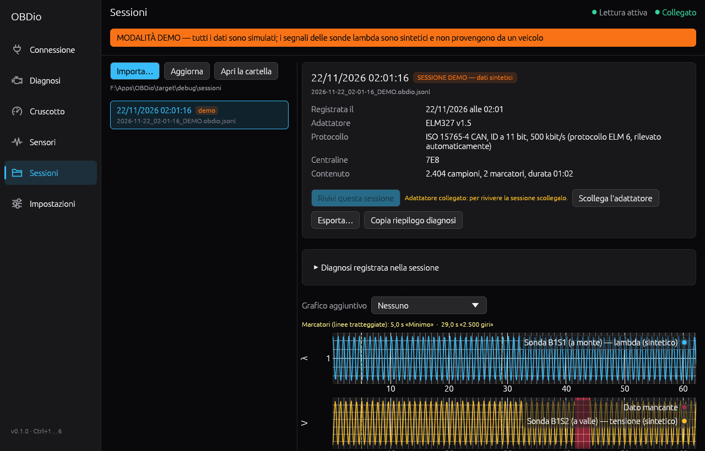

Nella scheda **Sessioni**:

- **Esporta…** (per la sessione aperta) offre quattro formati:
  - *Sessione OBDio (.obdio.jsonl)*: una copia del file, riapribile e
    importabile su un altro PC;
  - *CSV OBDio*: una riga per campione, il formato descritto sopra;
  - *CSV in stile Torque*: una riga per istante, una colonna `Nome(unità)` per
    parametro, `-` dove la lettura non ha dato un valore, per gli strumenti che
    leggono i registri di Torque (`trackLog.csv`);
  - *Diagnosi in JSON*: la diagnosi registrata nella sessione, senza VIN.
- **Importa…** legge una sessione OBDio, un CSV OBDio o un CSV in stile
  Torque; il formato si riconosce dal contenuto. Prima di salvare compare un
  riepilogo: formato, campioni, parametri riconosciuti, colonne conservate come
  parametri liberi, righe saltate e perché. **Salva e apri** crea nella cartella
  delle sessioni un file `…_IMPORTATA_<nome del file>.obdio.jsonl`; il file
  d'origine non viene toccato.

Importazione ed esportazione aprono la **finestra di sistema** per aprire o
salvare (con i tipi di file in italiano, per esempio *Sessione OBDio
(\*.obdio.jsonl)*, *CSV*, *JSON*, *Tutti i file*): la finestra si apre in un
thread a parte, quindi i dati in diretta e la registrazione continuano mentre è
aperta, e finché è aperta i pulsanti che ne aprirebbero un'altra sono
disabilitati. Ogni scopo (importare, esportare, riprodurre) riparte dall'ultima
cartella usata; la prima volta è *Documenti* (le sessioni, per «Riproduci»).
Salvando senza estensione, questa viene aggiunta. Su Android la finestra di
sistema non esiste (`rfd` non lo supporta): resta la finestra interna, con il
percorso scritto in un campo e l'elenco dei file adatti della cartella. Dopo
l'esportazione l'app dice dove ha scritto il file, con **Apri la cartella**.
Le finestre di sistema non sono state ancora provate a mano.

Regole che valgono sempre: un dato assente non diventa mai zero (in un CSV di
Torque `-` è importato come «risposta mancante» senza valore), nulla viene
scartato in silenzio (le colonne sconosciute di Torque diventano parametri
liberi con nome e unità, visibili in Sensori, grafici e cruscotto), un CSV
salvato da Excel in italiano (punto e virgola, virgola decimale) è accettato.
CSV OBDio esportato e reimportato restituisce esattamente gli stessi campioni,
stati, marcatori e origine. Il CSV in stile Torque invece non porta con sé
marcatori, centralina, diagnosi né l'indicazione «demo»: una sessione demo
esportata così e reimportata risulta come dati di veicolo. Tabelle delle
colonne di Torque riconosciute, conversioni di unità (°F, mph, psi) e dettagli
in [docs/FORMATO_CSV.md](docs/FORMATO_CSV.md).

> **Verifica.** Il formato Torque è stato provato solo con file scritti da
> OBDio e con un registro scritto a mano secondo le convenzioni documentate:
> **nessun registro prodotto dall'app Torque su un telefono** è stato
> importato. I nomi delle colonne di Torque riconosciuti sono scritti secondo
> le convenzioni note di Torque e **non sono stati confrontati con un registro
> reale**: una colonna con un nome diverso resta comunque, come parametro
> libero.

## Rivivere una sessione (riproduzione)

Una sessione salvata o importata si può **rivivere**: i campioni scorrono nel
tempo ed entrano per la stessa strada dei dati dal vivo, quindi cruscotto,
pagina Sensori, grafici e MQTT funzionano come con l'auto collegata.

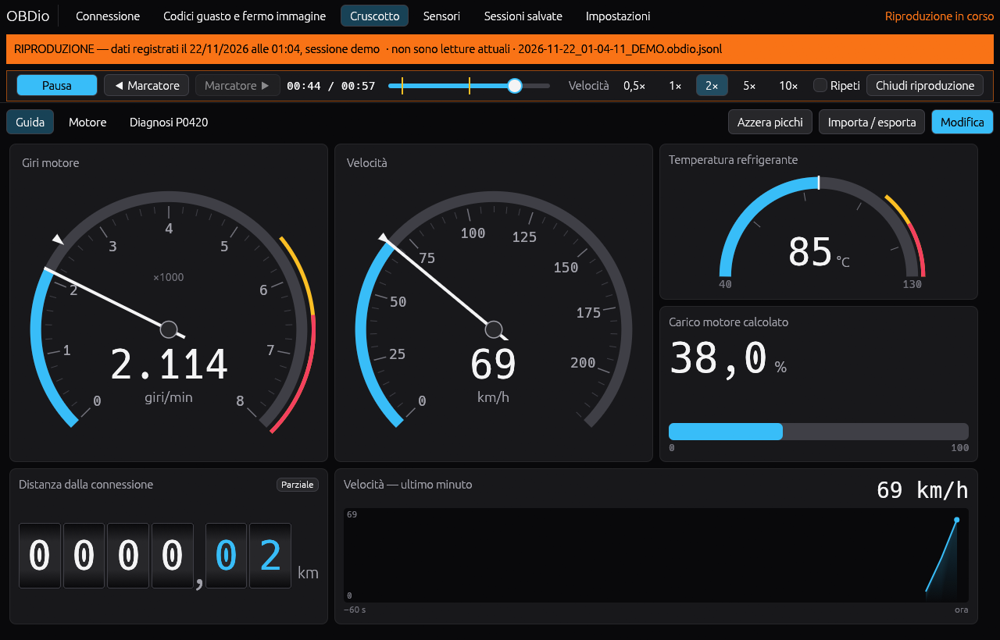

- Da **Sessioni**: apri la sessione e premi **Rivivi questa
  sessione**. Dalla scheda **Connessione**: **Riproduci una sessione…**.
  Con un adattatore collegato la riproduzione non parte: scollegalo prima
  (l'app offre il pulsante).
- Sotto la barra superiore, su ogni pagina, compaiono la fascia arancione
  «RIPRODUZIONE — dati registrati il …» (con «sessione demo» se lo era) e la
  **barra di trasporto**: riproduci/pausa, salto al marcatore precedente o
  successivo, posizione trascinabile con le tacche dei marcatori (passandoci
  sopra se ne legge il nome), tempo `mm:ss / mm:ss`, velocità 0,5×, 1×, 2×,
  5×, 10×, **Ripeti** e **Chiudi riproduzione**.
- Alla fine la riproduzione si ferma sull'ultimo istante («Ricomincia» la fa
  ripartire); con **Ripeti** riparte dall'inizio.
- Dopo un salto di posizione i grafici ripartono vuoti dal punto scelto: nulla
  di quanto precede viene riproposto e nessuna linea attraversa il salto.
- Durante la riproduzione **non si registra, non si aggiungono marcatori, non
  si legge né si cancella la diagnosi**: i pulsanti sono disattivati con la
  spiegazione e il thread di lavoro rifiuta comunque i comandi. La diagnosi
  mostrata è quella registrata nella sessione.
- Scorrono **tutti** i dati della sessione: la selezione dei sensori decide
  solo che cosa mostrare. Gli strumenti di un parametro assente nella sessione
  mostrano «Non supportato».
- Su MQTT i dati riprodotti escono con `"origine": "riproduzione"`, mai come
  dati del veicolo; la diagnosi registrata non viene pubblicata (l'argomento
  trattenuto `diagnosi` descrive lo stato attuale del veicolo).

Il tempo dei grafici è la posizione nella sessione (secondi dalla sua
partenza), non l'ora del PC; data e ora originali di ogni campione restano
quelle registrate.

### Riepilogo e VIN

**Copia riepilogo** copia negli appunti DTC, fermo immagine, protocollo,
monitor e parametri disponibili. Il VIN viene letto solo per essere mostrato a
schermo: è escluso dal riepilogo salvo spunta esplicita di «Includi il VIN nel
riepilogo», e non viene mai scritto nelle sessioni, nel CSV o nel registro.

## Cosa mostra la diagnosi

- **Codici guasto** confermati (servizio 03), in sospeso (07) e permanenti
  (0A), con centralina di origine. Lo stesso codice della stessa centralina
  occupa una sola riga con tutti gli stati rilevati.
- **Spia MIL** e **monitor di prontezza** (PID 01).
- **Fermo immagine** (servizio 02) in un riquadro separato dai dati dal vivo,
  con il DTC che la centralina dichiara come causa del fotogramma — anche se è
  diverso da quello atteso.
- **Monitor del catalizzatore** (Mode 06, MID 21) se esposto. Le unità
  derivano dalla tabella «Unit and Scaling ID» ripresa dal progetto
  python-OBD, **non confrontata con il testo SAE J1979**: accanto a ogni
  valore l'app mostra sempre il dato grezzo, e per gli identificativi fuori
  tabella mostra solo quello. L'app non giudica l'esito del test.

Per ogni dato lo stato è uno fra: **OK**, **Non supportato** (la centralina
non lo dichiara o lo rifiuta), **Risposta mancante** (dichiarato ma senza
risposta), **Errore di comunicazione** (timeout, errore di bus, risposta non
interpretabile).

## Cancellare i codici guasto

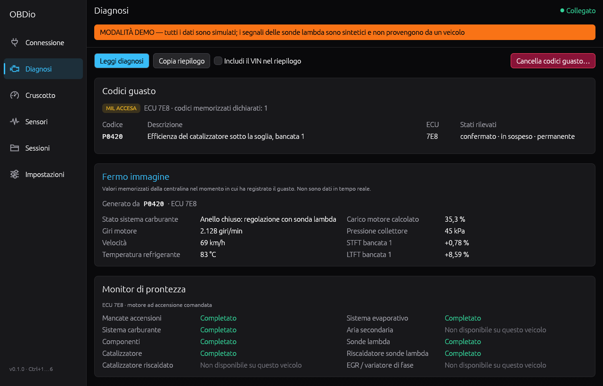

Nella scheda **Diagnosi**, il pulsante rosso **Cancella codici guasto…** (a
destra sul layout largo, in fondo alla pagina su quello stretto, comunque
lontano da *Leggi diagnosi*) invia il
servizio OBD 04. È attivo solo con l'adattatore collegato e nessuna
operazione in corso, e apre una finestra di conferma: il pulsante di
cancellazione si abilita solo dopo la spunta «Ho letto e voglio cancellare i
codici». *Annulla* è il pulsante predefinito; anche Esc annulla.

Cosa succede, nell'ordine:

1. se in questo collegamento non è ancora stata letta la diagnosi, l'app la
   legge;
2. salva una copia della diagnosi nella cartella `sessioni`:
   `diagnosi_prima_cancellazione_AAAA-MM-GG_HH-MM-SS.json` (`_DEMO` in demo),
   senza VIN. **Se la copia non si può scrivere, la cancellazione non parte**;
3. invia `04` e mostra l'esito per ogni centralina: eseguita, rifiutata con il
   motivo (per esempio «condizioni non corrette: di solito il motore deve
   essere spento con il quadro acceso»), nessuna risposta, oppure errore di
   comunicazione (esito incerto);
4. rilegge la diagnosi e la mostra. Se è in corso una registrazione, vi
   scrive il marcatore «Codici guasto cancellati» e la nuova diagnosi.

Conseguenze della cancellazione (servizio 04):

- spariscono i codici memorizzati e in sospeso, il **fermo immagine** (resta
  solo nella copia salvata) e i risultati dei monitor (Mode 06); la spia MIL
  si spegne;
- i **monitor di prontezza** tornano «non completato» e si azzerano distanza e
  tempo dalla cancellazione: finché i monitor non si completano (servono uno o
  più cicli di guida) il veicolo può non superare la revisione;
- i **codici permanenti** (servizio 0A) **non** si cancellano: li elimina la
  centralina da sola dopo alcuni cicli senza il guasto;
- cancellare non ripara nulla: se la causa resta, il codice ricompare.

Condizioni: quadro acceso, motore spento. Con il motore acceso molte
centraline rifiutano la richiesta.

> **Verifica.** La cancellazione è stata provata solo con il simulatore demo
> e con risposte a copione (accettata, rifiutata `7F 04 22`, nessuna risposta,
> collegamento caduto). **Non è mai stata provata su un veicolo.**

## MQTT

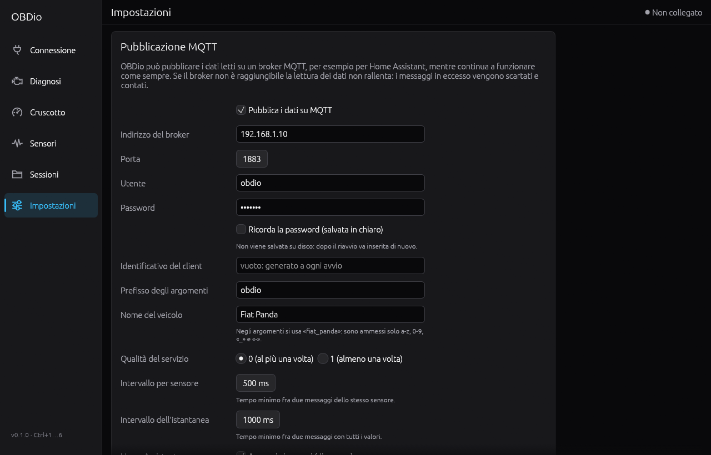

OBDio può pubblicare i dati in tempo reale su un broker MQTT (per esempio per
Home Assistant): un argomento per sensore, un JSON con tutti i valori, la
diagnosi e gli eventi. Si attiva dalla scheda **Impostazioni**; la
pubblicazione non rallenta mai la lettura. Il VIN non viene mai pubblicato e la
connessione **non è cifrata** (TLS non è supportato in questa versione).
Argomenti, esempi, discovery e note di sicurezza: [docs/MQTT.md](docs/MQTT.md).

## Server MCP per assistenti AI

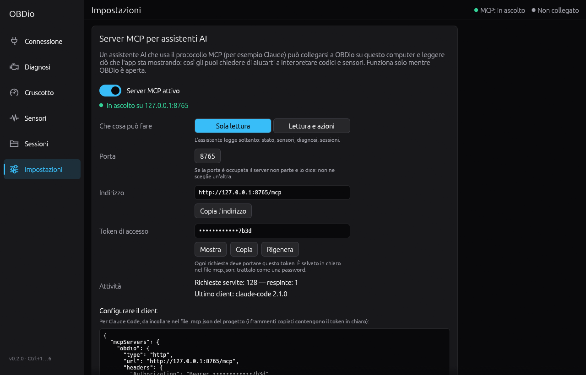

Un assistente AI che parla il protocollo MCP (per esempio Claude Code) può
collegarsi a OBDio mentre è aperta e leggere stato, sensori, diagnosi e
sessioni registrate, per aiutarti a interpretarli. Si accende con
l'interruttore in cima alla scheda **Impostazioni**, che mostra anche
indirizzo, token e la configurazione da copiare nel client.

- **Spento** finché non lo accendi; ascolta solo su `127.0.0.1`
  (`http://127.0.0.1:8765/mcp`) e ogni richiesta deve portare un token.
- Due livelli: **Sola lettura** (predefinito) e **Lettura e azioni** (avviare
  e fermare lettura e registrazione, marcatori, rilettura della diagnosi).
- Ogni risposta dice se i dati vengono dal veicolo, dalla demo o da una
  riproduzione; un valore assente è `null`, mai zero. Il VIN non esce mai.
- I **codici guasto non si possono cancellare** attraverso il server, in
  nessun caso.

Strumenti, esempi, modello di sicurezza con i suoi limiti e problemi comuni:
[docs/MCP.md](docs/MCP.md).

> **Verifica.** Provato con test automatici attraverso HTTP vero e, a mano,
> con `curl` e con `fetch` di Node.js. **Nessun assistente AI reale è stato
> collegato.**

## Aggiornamenti

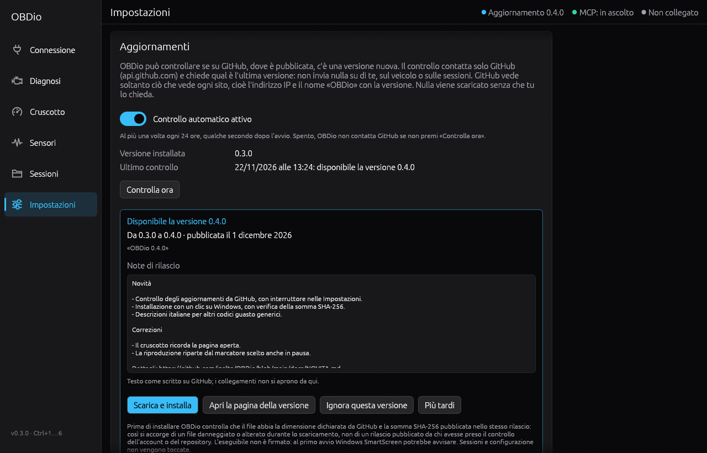

OBDio controlla su GitHub se c'è una versione nuova: in automatico al più una
volta al giorno, qualche secondo dopo l'avvio, oppure con **Controlla ora**
nella scheda *Aggiornamenti* delle Impostazioni, dove c'è anche l'interruttore
per spegnere il controllo automatico.

- Contatta solo GitHub (`api.github.com`; per scaricare `github.com` e
  `*.githubusercontent.com`), in HTTPS, senza account né cookie, e non invia
  nulla su di te, sul veicolo o sulle sessioni.
- Una versione nuova compare come avviso nella barra di stato e come riquadro
  con le note di rilascio: nessuna finestra si apre da sola.
- Su Windows x64 **Scarica e installa** scarica l'eseguibile, ne controlla
  dimensione e somma SHA-256 e lo mette al posto di quello in uso, che resta
  come `OBDio.vecchio.exe` fino al prossimo avvio. *Riavvia ora* o *Al
  prossimo avvio*. Sessioni e configurazione non vengono toccate.
- La verifica scopre un file danneggiato o alterato durante lo scaricamento,
  **non** un account o un repository GitHub compromessi. L'eseguibile non è
  firmato: SmartScreen può avvisare.
- Su Android l'app si aggiorna con il pacchetto: il controllo non esiste.

Come funziona, sicurezza e limiti, aggiornamento a mano, problemi comuni e i
nomi dei file che un rilascio deve avere:
[docs/AGGIORNAMENTI.md](docs/AGGIORNAMENTI.md).

> **Verifica.** Provato con test automatici contro un server HTTP di prova
> (scaricamento, verifica e sostituzione di un finto eseguibile) e con una
> richiesta vera a GitHub prima che il repository esistesse (risposta 404).
> La sostituzione è provata anche su un eseguibile in esecuzione (non OBDio).
> **Mai provati** un rilascio vero, OBDio che sostituisce sé stesso e
> riparte, e SmartScreen.

## Stato delle verifiche

### Adattatori Carista: cosa è documentato

Il modello esatto (Carista OBD bianco oppure Carista EVO) **va verificato**
sull'etichetta dell'adattatore.

| | Carista OBD (bianco) | Carista EVO |
|---|---|---|
| Compatibilità ELM327 | «ELM327 v1.4» secondo le FAQ Carista | «ELM327 v2.2» secondo le FAQ Carista |
| App di terze parti | Dichiarate supportate da Carista | Dichiarate supportate da Carista; nessuna prova indipendente trovata |
| Bluetooth LE | Indicato da più fornitori di app (OBD Auto Doctor, OBD Fusion) | Non documentato esplicitamente |
| Bluetooth Classic/SPP | Indicato come doppia modalità da OBD Auto Doctor (2017) | Non documentato |
| UUID GATT del canale dati | **Non pubblicati** | **Non pubblicati** |
| Uso su Windows | Non citato da Carista | Non citato da Carista |

Fonti: carista.com (FAQ e pagina delle app partner), obdautodoctor.com
(elenco adattatori supportati e articolo sugli adattatori BLE), obdsoftware.net.

Poiché Carista non pubblica gli UUID, l'app riconosce solo profili seriali
BLE documentati per adattatori ELM327 e non tenta altro:

| Profilo | Scrittura | Notifica | Fonte |
|---|---|---|---|
| Servizio `FFF0` | `FFF2` | `FFF1` | Note ufficiali OBDLink CX; diffuso fra gli adattatori ELM327 BLE |
| Servizio `18F0` | `2AF1` | `2AF0` | Vgate iCar Pro 2S (dump GATT pubblicato) |
| Servizio `FFE0` | `FFE1` | `FFE1` | Moduli seriali HM-10 |
| Nordic UART `6E400001-…` | `6E400002-…` | `6E400003-…` | Documentazione Nordic Semiconductor |

Una discussione su un forum suggerisce che il Carista usi `FFF0`, ma la fonte
non è verificabile: è un'ipotesi, non un dato.

### Cosa è stato provato

| Verifica | Esito |
|---|---|
| Test automatici (305: 261 unitari e 44 di integrazione in `tests/`, di cui 39 e 11 per gli aggiornamenti; più le prove di btleplug incluso, `cargo test --manifest-path vendor/btleplug/Cargo.toml --lib`): decoder con DTC multipli, fermo immagine assente o con DTC diverso, PID non supportati, risposte da più ECU, frammentazione dei dati, eco, NO DATA, timeout, perdita del collegamento, CSV, riapertura, cancellazione dei codici (accettata, rifiutata, senza risposta, caduta) | Superati |
| Flusso demo attraverso il thread di lavoro reale: collegamento, P0420, fermo immagine, polling con priorità alle sonde, registrazione, CSV, riapertura | Superato |
| Distanza parziale attraverso il thread di lavoro reale: campioni monotoni in km, registrati nella sessione e nel CSV | Superato |
| Cancellazione dei codici in demo attraverso il thread di lavoro reale: copia della diagnosi, servizio 04, rilettura con P0420 solo permanente, MIL spenta, prontezza azzerata | Superato |
| Finestra di conferma ed esito della cancellazione nell'interfaccia, in demo | Schermate dal collaudo automatico; clic, Esc e Invio a mano **non provati** |
| Cancellazione dei codici su un veicolo reale | **Non provata** |
| Conversazione MQTT reale fra il thread di lavoro (con la demo) e un broker di prova nello stesso processo (sette test): ultima volontà e credenziali nel CONNECT, stato in linea trattenuto, sensori numerici, istantanea con `null` per i valori assenti, diagnosi senza VIN, discovery, QoS 1, broker che cade e torna, chiusura con broker muto | Superato |
| Pubblicazione MQTT verso un broker vero (Mosquitto o altro) e discovery riconosciuta da Home Assistant | **Non provate** |
| Server MCP attraverso HTTP vero fra il thread di lavoro (con la demo) e un client di prova scritto nei test (sette test): stretta di mano `initialize`, elenco e chiamata degli strumenti, revisione 2026-07-28 senza stato, origine «demo» e «riproduzione» sempre dichiarata, valori numerici, lettura fallita come `null`, P0420 senza VIN, azioni rifiutate in sola lettura, nessuno strumento che cancelli i codici, `401` senza token, `403` con `Origin` o `Host` estranei, corpo e testata troppo grandi, porta occupata, quaranta richieste insieme, spegnimento e uscita senza blocchi | Superato |
| Server MCP con client HTTP indipendenti, a mano: `curl` (anche con `Expect: 100-continue`) e `fetch` di Node.js 24 (stretta di mano, strumenti, sessanta richieste insieme) contro il server dimostrativo | Superato |
| Server MCP con un assistente AI reale (Claude Code, Claude Desktop o altri client MCP) | **Non provato**: nessun client MCP disponibile sulla macchina di sviluppo. Il comando `claude mcp add --transport http …` è preso dalla documentazione, non eseguito |
| Scheda del server MCP nell'interfaccia | Schermate dal collaudo automatico, larghe e strette, con valori d'esempio (server non avviato dal collaudo); interruttore, «Copia», «Rigenera» e cambio di porta premuti a mano **non provati** |
| Interfaccia in demo, con schermate di **ogni pagina a 1280 × 820 e a 390 × 844** (layout da telefono): connessione, diagnosi, fermo immagine, grafici con buco del dato e marcatori, pagina Sensori (elenco, confronto, un grafico per sensore con diciassette sensori), sessioni (elenco e dettaglio), impostazioni, finestra di scelta del file, conferma ed esito della cancellazione, chiusura con il cruscotto non salvato | Superato |
| Cruscotto in demo, con schermate larghe e strette: «Guida» in movimento, «Diagnosi P0420» con l'interruzione della sonda a valle, modo Modifica con ispettore, una pagina con i sette tipi (parametro non supportato, risposta mancante), lettura avviata e fermata dal cruscotto | Superato; trascinamenti e ridimensionamenti col mouse **non provati** dal collaudo automatico |
| Aggiornamenti con un server HTTP di prova nello stesso processo (dieci dei suoi undici test di integrazione): ultimo rilascio, rinvio seguito, scaricamento con avanzamento, verifica di dimensione e SHA-256, sostituzione di un finto `OBDio.exe` in una cartella temporanea e pulizia di `OBDio.vecchio.exe`; binario alterato, dimensione diversa, somme mancanti, annullamento a metà (nessun file parziale), rinvio verso un host estraneo, giro di rinvii, limite di richieste `403`/`429`, `404`, risposta rotta, troppo grande o non UTF-8, tempo scaduto, versione non più nuova, cartella non scrivibile; il thread degli aggiornamenti | Superato |
| Sostituzione dell'eseguibile con un guasto simulato a ogni passo (rimozione del residuo, prima e seconda rinomina, ritorno indietro con rinomina e con copia, ritorno indietro impossibile) | Superato: con il nome `OBDio.exe` resta sempre la versione in uso, o l'errore dice dove sta |
| Controllo vero contro `api.github.com` (`cargo run --example controlla_aggiornamenti`), una volta, prima che il repository esistesse | Risposta 404, «nessuna versione pubblicata», attraverso HTTPS con SChannel |
| Sostituzione di un eseguibile davvero in esecuzione su Windows 11 (una copia di `ping.exe` aperta durante la prova): rinomina riuscita, sovrascrittura diretta impossibile, pulizia di `OBDio.vecchio.exe` rimandata finché il processo vive e riuscita dopo | Superato (undicesimo test di integrazione) |
| Rilascio vero su GitHub (1.0.0) visto da una build 0.3.0: controllo, scaricamento con i rinvii reali verso `githubusercontent.com`, verifica di dimensione e SHA-256, sostituzione di una copia di `OBDio.exe` in una cartella di prova (`cargo run --example prova_installazione`) | Superato: il file installato ha la stessa somma SHA-256 del rilascio e si avvia; un secondo tentativo viene rifiutato perché la versione non è più nuova |
| Un `OBDio.exe` che sostituisce sé stesso dall'interfaccia, «Riavvia ora», SmartScreen e antivirus, cartella in sola lettura vera (`Program Files`) | **Non provati**: la sostituzione reale è stata fatta da un programma di prova su una copia, non dall'app in esecuzione; la cartella non scrivibile è provata con una cartella inesistente |
| Scheda Aggiornamenti nell'interfaccia | Schermate dal collaudo automatico, larghe e strette, con un rilascio d'esempio (nessuna richiesta in rete) e con l'avanzamento dello scaricamento; pulsanti premuti a mano **non provati** |
| Uso col dito su un telefono vero, tastiera Ctrl+1…6 premuta a mano | **Non provati**: il layout stretto è verificato solo restringendo la finestra su Windows |
| Nuovi PID (contachilometri, pedale, coppia, consumo, pressioni…) su un veicolo reale | **Non provati**: formule da Wikipedia, verificate solo con test sui valori; quelle dei PID 49, 4A e 4C sono dedotte |
| Riproduzione attraverso il thread di lavoro reale: sessione demo registrata, riaperta e rivissuta a 10× con gli stessi campioni (letture fallite comprese) e marcatori; pausa, salto avanti e indietro, ripetizione; registrazione, marcatori, lettura e cancellazione della diagnosi rifiutati; MQTT con origine «riproduzione»; sessione Torque importata con parametri liberi | Superato |
| Importazione ed esportazione: andata e ritorno esatti del CSV OBDio, CSV in stile Torque scritto e riletto, conversioni °F/mph/psi, file troncati, colonne in più o in meno, byte non UTF-8, BOM, CR LF e LF, CSV di Excel in italiano, intestazione ripetuta o sola | Superato (test automatici) |
| Importazione di un registro prodotto davvero dall'app Torque | **Non provata**: solo file scritti da OBDio o a mano |
| Riproduzione, importazione ed esportazione nell'interfaccia, in demo | Schermate dal collaudo automatico (esportazione Torque, anteprima dell'importazione, riproduzione con il cruscotto «Guida», salto e pausa con la pagina Sensori); trascinamento del cursore col mouse **non provato** |
| Avviso «L'ultima volta OBDio si è chiuso per un errore» e scheda Registri nell'interfaccia; esiti BLE (accesso negato, errore interno, thread di lavoro fermo) con `OBDIO_PROVA_BLE=1` | Schermate dal collaudo automatico; pulsanti premuti a mano **non provati** |
| Diagnosi `OBDio.exe --diagnosi-ble` | Solo compilata e provata nella scelta del dispositivo (test): **non eseguita** su un adattatore |
| Scansione BLE reale su un PC Windows 11 | Funziona (dispositivi elencati); nessun Carista presente |
| Connessione BLE a un adattatore reale | **Non provata** con esito positivo: vedi la riga seguente |
| Chiusura improvvisa durante il collegamento BLE a un Carista reale (segnalata con la 1.0.0 su un altro PC Windows 11: Carista `00:11:22:33:44:55` visto a −55 dBm, «Collegamento all'adattatore…» per circa 13 s, poi la finestra sparisce senza messaggi) | **Correzione non confermata sull'adattatore.** Non riproducibile qui (nessun Carista sulla macchina di sviluppo). Causa sospettata, non provata: un `unwrap()` di btleplug 0.13.5 dentro un gestore di eventi WinRT (`MaxPduSizeChanged`, `MaxPduSize()` che fallisce mentre il collegamento cade); da Rust 1.81 un panic lì abortisce il processo. Cambiato: btleplug incluso in `vendor/btleplug` con tutti i panic dei percorsi WinRT tolti ([PATCH_OBDIO.md](vendor/btleplug/PATCH_OBDIO.md)); registro degli errori scritto prima di un abort (provato con un processo di prova che va in panic in un callback `extern "system"`), registro dei collegamenti passo per passo, avviso al riavvio; errori interni del thread di lavoro intercettati (provato con un trasporto di prova che va in panic); tempi massimi e messaggi per ogni passo BLE, un nuovo tentativo, scansione fermata prima di collegarsi, accesso negato riconosciuto; diagnosi `OBDio.exe --diagnosi-ble`. Da fare sul PC della segnalazione: riprovare e inviare la cartella `registri` (vedi [docs/DIAGNOSI_PROBLEMI.md](docs/DIAGNOSI_PROBLEMI.md)) |
| Connessione seriale/SPP a un adattatore reale | **Non provata** |
| Lettura da una centralina reale (208 o altro) | **Non provata** |

## Controlli da fare sull'auto

1. **Modello dell'adattatore**: annota se è Carista OBD o Carista EVO.
2. **Scansione BLE**: l'adattatore compare nell'elenco? Annota il nome con cui
   si annuncia.
3. **Connessione BLE**:
   - se appare «Profilo BLE sconosciuto», copia l'elenco degli UUID: serve
     per aggiungere il profilo corretto (file `src/transport/profili.rs`);
   - se si collega, annota il profilo riconosciuto mostrato in *Connessione*.
4. **Se il BLE non funziona**: prova l'associazione classica in Windows e la
   porta COM in uscita.
5. **Adattatore**: la stringa di identificazione (attesa `ELM327 v1.4` o
   `v2.2`) e l'assenza di errori nel registro durante l'inizializzazione.
6. **Protocollo e centralina**: attesi ISO 15765-4 CAN, 11 bit, 500 kbit/s,
   ECU `7E8`, come rilevato dal lettore già funzionante.
7. **Diagnosi**: P0420 presente e con quali stati; confronta fermo immagine,
   MIL e monitor con il lettore già funzionante.
8. **Segnali delle sonde**: quali PID espone davvero la centralina HMZ per
   B1S1 (lambda `24`/`34` oppure tensione `14`) e per B1S2 (`15` o altro).
9. **Frequenza di aggiornamento**: i valori Hz ottenuti via Bluetooth per le
   sonde e per gli altri parametri.
10. **Registrazione**: tre fasi con marcatori, poi verifica di CSV e
    riapertura della sessione.
11. **Distacco**: sfila l'adattatore (o spegni il quadro) durante una
    registrazione e verifica che il polling si fermi e il file resti leggibile.
12. **Mode 06**: se la centralina espone il MID 21, annota TID, scala e valori
    grezzi mostrati.
13. **PID 4F**: se in *Connessione* compare un avviso sui fondi scala delle
    sonde a banda larga, i valori λ/V/mA vanno considerati non verificati.

## Limiti noti

- Sui protocolli non CAN (J1850, ISO 9141-2, KWP2000) sono letti DTC,
  prontezza, fermo immagine e dati dal vivo; Mode 06 e VIN no. Questi
  protocolli sono coperti solo da test sul formato delle trame.
- Le descrizioni dei DTC coprono i 9.533 codici generici (P0, P2, P3, B0, C0,
  U0, U3) in italiano: circa 55 curate a mano, le altre tradotte
  automaticamente e non riviste da un tecnico (accanto resta il titolo inglese
  originale; vedi [docs/FONTI_DATI.md](docs/FONTI_DATI.md)). I
  codici del costruttore (per esempio P1xxx) mostrano solo il codice.
- Il PID 4F (fondi scala dichiarati dalla centralina) viene segnalato ma non
  applicato alle formule.
- Viene letto il solo fotogramma 0 del fermo immagine.
- Le formule dei PID seguono le definizioni pubbliche di SAE J1979 (come
  riportate da Wikipedia «OBD-II PIDs»).

## Comandi inviati

L'elenco è chiuso nel codice (`AtCommand` in `src/elm.rs`, `ObdRequest` in
`src/obd/mod.rs`) e un test verifica che le letture non possano generare altri
servizi, `04` compreso.

- **Adattatore** (configurazione che non tocca il veicolo): `ATZ`, `ATE0`,
  `ATL0`, `ATS0`, `ATH1`, `ATAT1`, `ATSP0`, `ATDPN`, `ATI`, `ATRV`.
  `ATSP0` imposta la scelta automatica del protocollo, che è anche il valore
  di fabbrica; le altre impostazioni si annullano togliendo alimentazione.
- **Veicolo**, servizi di lettura: `01` (dati correnti), `02` (fermo
  immagine), `03`, `07`, `0A` (lettura DTC), `06` (risultati dei monitor),
  `09 02` (VIN).
- **Veicolo, unica eccezione**: `04` (cancellazione DTC), solo dall'azione
  confermata *Cancella codici guasto*. Ha un percorso separato
  (`Elm::cancella_dtc`) che non si può chiamare senza un valore
  `ConfermaCancellazione`, creato soltanto dalla finestra di conferma.

Mai inviati: `08`, servizi UDS di scrittura, codifica o comando attuatori,
comandi liberi.

## Android

Il codice è predisposto per Android (Fase 7 del piano), ma **non è stato
compilato né provato**: non esiste un APK, non c'è un NDK su questa macchina e
nulla è stato installato su un telefono. Il percorso di compilazione e le
prove da fare per primo sono in [docs/ANDROID.md](docs/ANDROID.md).

## Compilare dai sorgenti

Serve Rust stabile (verificato con 1.93.1, toolchain `x86_64-pc-windows-msvc`).

```
cargo test
cargo build --release
```

Dipendenze principali: `eframe`/`egui` 0.35 e `egui_plot` 0.36 (interfaccia e
grafici; sono le ultime versioni compatibili con Rust 1.93), `btleplug` 0.13
(Bluetooth LE tramite le API WinRT), `serialport` 4 (porte COM), `ureq` 3 con
`native-tls` (HTTPS per gli aggiornamenti con il TLS del sistema, SChannel su
Windows: nessun codice crittografico in C da compilare) e `sha2` 0.11 (SHA-256
in Rust puro). Su Linux `native-tls` usa OpenSSL: servono le sue librerie di
sviluppo.

Struttura:

| Modulo | Compito |
|---|---|
| `transport/` | Canale di byte: `ble`, `serial`, `demo`, più i profili GATT ammessi |
| `elm.rs` | Dialogo ELM327: una richiesta alla volta, prompt, eco, righe multiple, errori |
| `obd/` | Decoder: trame e ISO-TP, PID, DTC, prontezza, Mode 06 |
| `diagnosis.rs` | Lettura di DTC, MIL, prontezza, fermo immagine, Mode 06 |
| `recording.rs` | Sessioni su disco e CSV |
| `mqtt.rs` | Pubblicazione MQTT: argomenti, limitazione di frequenza, coda non bloccante, discovery |
| `mcp/` | Server MCP locale per assistenti AI: archivio condiviso, strumenti, protocollo, trasporto HTTP |
| `aggiornamenti/` | Controllo e installazione delle versioni nuove da GitHub (solo desktop): versioni, rilascio, somme SHA-256, pianificazione, HTTPS con host ammessi, sostituzione dell'eseguibile |
| `worker.rs` | Thread di lavoro con stati espliciti: scansione, connessione, diagnosi, cancellazione, polling, registrazione, disconnessione |
| `ui/` | Interfaccia egui: non esegue mai I/O verso l'adattatore |
| `ui/tema.rs` | Token visivi (colori, spaziature, raggi, caratteri) applicati a egui |
| `ui/cruscotto/` | Cruscotto: modello e griglia, sorgenti dei dati, disegno degli strumenti, modo Modifica |

Strumenti di sviluppo:

- `cargo run --example scansione_ble` elenca porte COM e dispositivi BLE
  senza collegarsi a nulla;
- `cargo run --example controlla_aggiornamenti` fa il controllo vero degli
  aggiornamenti contro GitHub (una richiesta, nessuno scaricamento) e stampa
  che cosa vede l'app;
- `cargo build --features collaudo`, poi avvio con la variabile d'ambiente
  `OBDIO_COLLAUDO=<cartella>`: l'app percorre da sola il flusso demo e salva
  una schermata per ogni passo. Con questa funzione il controllo automatico
  degli aggiornamenti è disattivato: il collaudo non contatta la rete.
