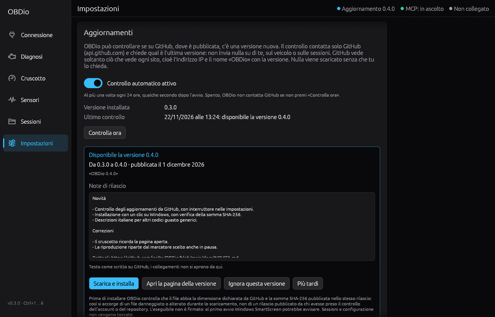

# Aggiornamenti

OBDio può controllare se su GitHub è uscita una versione nuova e, su Windows
a 64 bit, installarla con un clic. Nulla succede senza dirlo: una versione
nuova compare come avviso nella barra di stato e come riquadro nella scheda
**Aggiornamenti** delle Impostazioni, e lo scaricamento parte solo quando
premi *Scarica e installa*.



- **Che cosa viene contattato**: solo GitHub, cioè `api.github.com` per
  sapere qual è l'ultima versione e, se scegli di installarla, `github.com` e
  `*.githubusercontent.com` per scaricare i file.
- **Che cosa viene inviato**: una richiesta `GET` senza account, senza cookie e
  senza identificativi, con le intestazioni `User-Agent: OBDio/<versione>` e
  `Accept`. Niente su di te, sul veicolo, sulle sessioni o sulle
  impostazioni. GitHub vede ciò che vede ogni sito: l'indirizzo IP da cui
  arriva la richiesta, l'ora e il nome «OBDio» con la versione.
- **Quando**: in automatico al più una volta ogni 24 ore, circa otto secondi
  dopo l'avvio (l'avvio non aspetta mai la rete), e ogni volta che premi
  *Controlla ora*.
- **Dove**: su Windows, Linux e macOS. Su Android l'app si aggiorna con il
  pacchetto (APK o store) e il controllo non esiste nemmeno nel codice
  compilato.

Il controllo gira in un thread a parte: non rallenta né interrompe la lettura
dei sensori, la registrazione, la riproduzione, MQTT o il server MCP. Senza
rete l'app funziona come sempre; la scheda dice soltanto che GitHub non è
raggiungibile.

## Spegnere il controllo automatico

Impostazioni → **Aggiornamenti** → interruttore *Controllo automatico*. Da
spento OBDio non contatta più GitHub da sola; *Controlla ora* resta
disponibile. La scelta è salvata in `configurazione\aggiornamenti.json`:

```json
{
  "automatico": false,
  "ultimo_controllo": 1795000000,
  "ultimo_esito": "nessuna versione nuova (ultima: 0.3.0)",
  "ultima_versione_vista": "0.3.0",
  "ignora_versione": null,
  "non_prima_di": null
}
```

Con `"automatico": false` scritto a mano prima del primo avvio, OBDio non fa
mai alcuna richiesta in rete per gli aggiornamenti. Un file illeggibile vale
come assente (controllo acceso) e la scheda lo dice in rosso.

## Che cosa fanno i pulsanti

Quando c'è una versione nuova la scheda mostra versione installata → nuova,
data di pubblicazione e note di rilascio (testo semplice, scorrevole; i
collegamenti non si aprono da soli). Poi:

| Pulsante | Effetto |
|---|---|
| **Scarica e installa** | Scarica l'eseguibile, lo verifica e lo mette al posto di quello in uso (vedi sotto). Mostra l'avanzamento e si può annullare. |
| **Apri la pagina della versione** | Apre la pagina del rilascio su `github.com` nel browser. |
| **Ignora questa versione** | Non la propone più (né avviso né riquadro). Una versione ancora più nuova viene proposta di nuovo; *Controlla ora* la mostra comunque, con una nota. |
| **Più tardi** | Toglie l'avviso dalla barra e chiude il riquadro fino al prossimo avvio. |

Dopo un'installazione riuscita: **Riavvia ora** chiude OBDio come quando la
chiudi tu (la registrazione in corso viene chiusa e salvata, MQTT e MCP si
fermano) e poi apre la versione nuova con la stessa cartella di lavoro;
**Al prossimo avvio** lascia tutto com'è, la versione nuova parte la prossima
volta. Se il cruscotto ha modifiche non salvate, prima compare la solita
domanda; *Annulla* annulla anche il riavvio.

L'installazione è rifiutata, con il motivo scritto sotto i pulsanti:

- durante una **registrazione** (fermala prima) o una **cancellazione dei
  codici guasto**;
- se il rilascio non contiene il file atteso per Windows x64;
- su un sistema diverso da Windows x64 (lì restano l'avviso e *Apri la pagina
  della versione*);
- da una **build di sviluppo** (`cargo build` senza `--release`) o da un
  eseguibile dentro una cartella `target`: così uno sviluppatore non
  sovrascrive i file di compilazione. Solo le prove automatiche possono
  scavalcare il blocco, con la variabile d'ambiente
  `OBDIO_AGGIORNAMENTI_PROVA_INSTALLAZIONE=1`.

## Come avviene l'installazione

1. OBDio controlla che nella cartella dell'eseguibile si possa scrivere.
2. Scarica `SHA256SUMS.txt` del rilascio e ne legge la somma dell'eseguibile.
3. Scarica `OBDio-<versione>-windows-x64.exe` accanto a `OBDio.exe` con il nome
   temporaneo `OBDio.exe.nuovo`, contando i byte e calcolando lo SHA-256
   mentre arrivano.
4. Lo rifiuta (e lo elimina) se la dimensione non è quella dichiarata
   dall'API di GitHub o se la somma non è quella di `SHA256SUMS.txt`. Lo stesso
   se annulli o se la connessione cade: non resta mai un file a metà.
5. Lo scrive su disco (sincronizzazione) e poi, poiché Windows non lascia
   sovrascrivere un programma in esecuzione ma lascia rinominarlo:
   - `OBDio.exe` → `OBDio.vecchio.exe`;
   - `OBDio.exe.nuovo` → `OBDio.exe`.
6. Se il secondo passo fallisce, torna indietro (`OBDio.vecchio.exe` →
   `OBDio.exe`, oppure una copia): con il nome `OBDio.exe` resta sempre un
   eseguibile funzionante. Nel caso, rarissimo, in cui anche il ritorno
   indietro fallisca, la scheda dice dove sta la copia della versione in uso
   (`OBDio.vecchio.exe`) da rinominare a mano.

**La versione precedente** resta come `OBDio.vecchio.exe` nella stessa
cartella finché OBDio non riparte; al successivo avvio riuscito viene
eliminata (se è ancora bloccata dalla chiusura della copia precedente, OBDio
riprova dopo qualche secondo e poi più tardi, senza mai bloccare l'avvio).
Anche un `OBDio.exe.nuovo` rimasto da un'interruzione viene eliminato.

**I dati non vengono toccati**: le cartelle `sessioni` e `configurazione`, ed
eventuali file in `Documenti\OBDio`, restano come sono.

L'app rifiuta di «aggiornare» a una versione che non sia strettamente più
nuova di quella installata, ignora bozze e pre-rilasci (`v1.0.0-rc1`) e
considera sconosciuta, mai più nuova, un'etichetta che non si legge come
versione.

## Sicurezza e limiti

- **HTTPS** con il TLS di Windows (SChannel) e i certificati radice del
  sistema: la verifica del certificato è sempre attiva. Su Linux e macOS si usa
  il TLS del sistema (OpenSSL, Security Framework).
- **Solo host noti**: `api.github.com` per il controllo; `github.com` e i
  sottodomini di `githubusercontent.com` per i file. I rinvii (`3xx`) si
  seguono a mano, al più cinque, e solo verso HTTPS e verso questi host; un
  indirizzo con credenziali o con una porta diversa da 443 è rifiutato.
- **Tempi e dimensioni massimi**: 15 s per collegarsi, 30 s per ogni lettura,
  45 s per l'intera richiesta all'API; al più 2 MB per la risposta dell'API,
  64 kB per `SHA256SUMS.txt`, 200 MB per l'eseguibile. Una risposta rotta o
  troppo grande dà un messaggio, mai un arresto dell'app.
- **Verifica del file**: dimensione dichiarata dall'API e SHA-256 da
  `SHA256SUMS.txt` dello stesso rilascio.

Che cosa **garantisce** questa verifica: che il file installato sia
esattamente quello caricato nel rilascio, cioè che non si sia rovinato
durante lo scaricamento e che nessuno lo abbia sostituito lungo la strada
(una rete che lo altera, un server intermedio).

Che cosa **non garantisce**: che il rilascio sia stato pubblicato da chi
sviluppa OBDio. Le somme arrivano dallo stesso rilascio dell'eseguibile: chi
prendesse il controllo dell'account o del repository GitHub potrebbe
pubblicare un eseguibile e somme coerenti fra loro, e OBDio lo installerebbe.
Anche il controllo della versione si fida di ciò che risponde GitHub.

**L'eseguibile non è firmato** con un certificato di firma del codice:
Windows SmartScreen può mostrare «Windows ha protetto il PC» al primo avvio
di una versione nuova. *Ulteriori informazioni* → *Esegui comunque* lo
avvia; nel dubbio, confronta prima la somma SHA-256 a mano (vedi sotto).

## Aggiornare a mano

1. Apri <https://github.com/inalto/OBDio/releases/latest> (o *Apri la pagina
   della versione* nella scheda).
2. Scarica `OBDio-<versione>-windows-x64.zip` (pacchetto portatile) oppure
   `OBDio-<versione>-windows-x64.exe` (solo l'eseguibile), e `SHA256SUMS.txt`.
3. Controlla la somma in PowerShell e confrontala con la riga dello stesso
   file in `SHA256SUMS.txt`:

   ```
   Get-FileHash .\OBDio-0.4.0-windows-x64.exe -Algorithm SHA256
   ```

4. Chiudi OBDio e sostituisci `OBDio.exe` nella sua cartella con il file
   scaricato rinominato `OBDio.exe` (dallo zip: copia `OBDio.exe` e gli altri
   file del pacchetto sopra quelli vecchi). Le cartelle `sessioni` e
   `configurazione` restano dove sono.

## Problemi comuni

| Problema | Che cosa fare |
|---|---|
| *GitHub non è raggiungibile* | Nessuna connessione, oppure un firewall o un proxy bloccano `api.github.com`. Il resto dell'app funziona; riprova più tardi. Un proxy indicato nelle variabili d'ambiente `HTTPS_PROXY`/`ALL_PROXY` viene usato. |
| *GitHub ha limitato le richieste* | Senza account GitHub accetta circa 60 richieste all'ora per indirizzo IP, condivise con gli altri programmi e le altre persone della stessa rete. La scheda dice dopo che ora riprovare e il controllo automatico aspetta da solo. |
| *Su GitHub non è ancora pubblicata nessuna versione* | Il repository non ha ancora rilasci (o solo pre-rilasci). |
| *Nella cartella … non si può scrivere* | OBDio sta in una cartella protetta, per esempio `C:\Program Files`. L'app non chiede i permessi di amministratore: sposta la cartella di OBDio in una tua (per esempio `Documenti`) oppure aggiorna a mano. |
| L'antivirus blocca o mette in quarantena il file | Succede con eseguibili nuovi e non firmati. Il file scaricato si chiama `OBDio.exe.nuovo` finché non è verificato; se l'antivirus lo toglie, l'installazione fallisce e `OBDio.exe` resta quello di prima. Aggiorna a mano dopo aver controllato la somma. |
| SmartScreen: «Windows ha protetto il PC» | Vedi sopra: l'eseguibile non è firmato. |
| *Il file scaricato non corrisponde alla somma SHA-256* | Il file è arrivato diverso da quello pubblicato. È stato eliminato: riprova; se si ripete, segnalalo e non installare a mano quel file. |
| *Una copia precedente … non si può eliminare* | Un'altra finestra di OBDio (versione vecchia) è ancora aperta: chiudila e riprova. |
| `OBDio.vecchio.exe` resta nella cartella | Viene eliminato al prossimo avvio; se resta, è ancora in uso o protetto: lo puoi cancellare a mano a OBDio chiusa. |

## Per chi pubblica una versione

L'app legge `GET https://api.github.com/repos/inalto/OBDio/releases/latest`,
cioè l'ultimo rilascio **pubblicato**, non bozza e non pre-rilascio.

- **Etichetta git**: `vMAGGIORE.MINORE.CORREZIONE`, per esempio `v0.4.0`,
  senza zeri iniziali (`v0.10.0`, non `v0.010.0`). La `v` è facoltativa ma
  consigliata. Un suffisso di pre-rilascio (`v1.0.0-rc1`) o la casella
  «pre-release» di GitHub fanno ignorare il rilascio. La versione
  dell'etichetta deve coincidere con `version` di `Cargo.toml` della build
  pubblicata, altrimenti dopo l'installazione l'app riproporrebbe la stessa
  versione.
- **File del rilascio** (nomi esatti, maiuscole comprese; `<v>` è la versione
  senza la `v`, per esempio `0.4.0`):

  | File | Contenuto | Usato dall'app |
  |---|---|---|
  | `OBDio-<v>-windows-x64.exe` | L'eseguibile, gli stessi byte di `OBDio.exe` nel pacchetto | Sì: è il file che installa |
  | `SHA256SUMS.txt` | Le somme SHA-256 | Sì: obbligatorio, senza non installa nulla |
  | `OBDio-<v>-windows-x64.zip` | Pacchetto portatile | No (solo per chi aggiorna a mano) |

- **Formato di `SHA256SUMS.txt`**: una riga per file, come la scrive
  `sha256sum`: 64 cifre esadecimali, due spazi (oppure spazio e asterisco),
  nome del file. Fine riga LF o CR LF; maiuscole o minuscole nelle cifre; le
  righe in un altro formato vengono ignorate. Deve contenere almeno la riga
  dell'eseguibile; due righe con somme diverse per lo stesso nome fanno
  rifiutare l'installazione. Per esempio:

  ```
  3f1c…(64 cifre)…9ab2  OBDio-0.4.0-windows-x64.exe
  77d0…(64 cifre)…c4e1  OBDio-0.4.0-windows-x64.zip
  ```

  In PowerShell, dalla cartella con i due file:

  ```
  Get-ChildItem OBDio-0.4.0-windows-x64.* | ForEach-Object {
    "{0}  {1}" -f (Get-FileHash $_ -Algorithm SHA256).Hash.ToLower(), $_.Name
  } | Set-Content -Encoding ascii SHA256SUMS.txt
  ```

- La dimensione dell'eseguibile caricato deve essere quella che GitHub
  dichiara (lo è sempre, se il caricamento è completo): un file ancora in
  caricamento viene ignorato.
- Dopo la pubblicazione, `cargo run --example controlla_aggiornamenti` fa il
  controllo vero contro GitHub e stampa che cosa vede l'app: etichetta, file
  attesi presenti o mancanti, valutazione rispetto alla versione della build.

## Verifiche fatte e non fatte

- **Provato con test automatici** (`src/aggiornamenti/` e
  `tests/aggiornamenti.rs`, con un server HTTP di prova nello stesso
  processo): lettura e confronto delle versioni, lettura della risposta
  dell'API, `SHA256SUMS.txt`, pianificazione con un orologio finto, versione
  ignorata, host ammessi e rinvii, limite di richieste, risposte rotte e
  troppo grandi, tempo scaduto, scaricamento con rinvio, verifica,
  sostituzione di un finto eseguibile in una cartella temporanea, binario
  alterato, dimensione diversa, annullamento a metà, guasto simulato a ogni
  passo della sostituzione con ritorno indietro.
- **Provato su Windows 11** con un eseguibile davvero in esecuzione (una
  copia di `ping.exe` aperta durante la prova): la rinomina riesce dove la
  sovrascrittura fallisce, e la pulizia di `.vecchio.exe` aspetta che il
  processo finisca.
- **Provato a mano** una volta contro GitHub vero, prima che il repository
  esistesse: risposta 404, cioè *nessuna versione pubblicata*, attraverso
  HTTPS con SChannel.
- **Non provati**: un rilascio vero su GitHub (compresi i rinvii reali verso
  `githubusercontent.com`), OBDio che sostituisce sé stesso e riparte con
  «Riavvia ora», il comportamento di SmartScreen e degli antivirus, una
  cartella davvero protetta (`Program Files`; provata solo una cartella
  inesistente), la build su Linux e macOS, la compilazione per Android.
