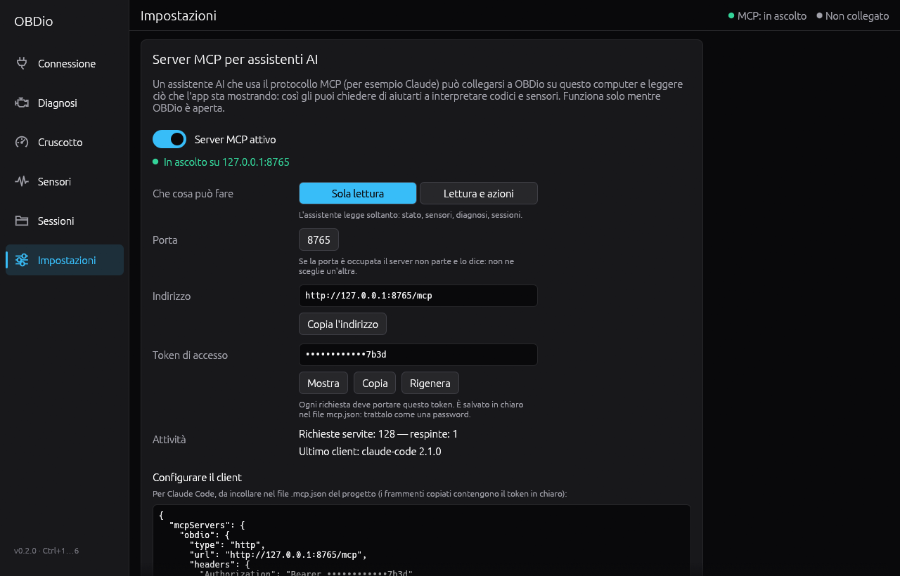

# Server MCP per assistenti AI

OBDio può fare da **server MCP** (Model Context Protocol): un assistente AI
che parla questo protocollo, per esempio Claude Code o Claude Desktop, si
collega all'app mentre è aperta e legge ciò che l'app sta mostrando. Così gli
si può chiedere «che cosa vuol dire questo codice?», «come si comporta la
sonda a valle nell'ultimo minuto?», «riassumi la sessione di ieri».

- **Spento** finché non lo accendi. Funziona solo mentre OBDio è aperta.
- **Solo su questo computer**: ascolta su `127.0.0.1`, mai sulla rete.
- Ogni richiesta porta un **token** casuale.
- Il **VIN non esce mai**.
- I **codici guasto non si possono cancellare** da qui, in nessun caso: serve
  una persona davanti allo schermo (pagina Diagnosi).



## Accenderlo

1. Apri **Impostazioni**. La prima scheda è *Server MCP per assistenti AI*.
2. Premi l'interruttore: diventa **Server MCP attivo** e sotto compare
   *In ascolto su 127.0.0.1:8765*. La prima volta viene creato il token.
3. Scegli che cosa può fare l'assistente: **Sola lettura** (predefinito) o
   **Lettura e azioni**.
4. Copia la configurazione per il client con *Copia il JSON* o *Copia il
   comando* (vedi sotto).

Ogni scelta vale subito e viene salvata in `configurazione\mcp.json` accanto
all'eseguibile; se il server era acceso, riparte da solo al prossimo avvio
dell'app. Nella barra di stato in alto compare **MCP: in ascolto** (un clic
porta alle Impostazioni). Per spegnerlo, premi di nuovo l'interruttore: la
porta viene chiusa subito.

Se la porta è occupata da un altro programma il server **non parte** e lo
dice in rosso: non ne sceglie un'altra da solo, perché il client punterebbe
all'indirizzo sbagliato. Cambia la porta e premi *Applica*.

## Configurare il client

Indirizzo: `http://127.0.0.1:8765/mcp` (trasporto «Streamable HTTP»).
Intestazione obbligatoria: `Authorization: Bearer <token>`.

**Claude Code**, dal terminale:

```
claude mcp add --transport http obdio http://127.0.0.1:8765/mcp --header "Authorization: Bearer <token>"
```

oppure nel file `.mcp.json` del progetto:

```json
{
  "mcpServers": {
    "obdio": {
      "type": "http",
      "url": "http://127.0.0.1:8765/mcp",
      "headers": {
        "Authorization": "Bearer <token>"
      }
    }
  }
}
```

La sintassi del comando è quella della documentazione di Claude Code
(<https://code.claude.com/docs/en/mcp>, «Add a remote HTTP server») letta il
22 novembre 2026. Altri client MCP che accettano un indirizzo HTTP e
un'intestazione personalizzata si configurano allo stesso modo; quelli che
sanno solo avviare un programma (trasporto «stdio») hanno bisogno di un ponte
da stdio a HTTP, che OBDio non fornisce.

Il token non scade. Con **Rigenera** se ne crea uno nuovo e quello vecchio
smette di valere all'istante: i client vanno aggiornati.

## Che cosa vede l'assistente

Ogni risposta dice **da dove vengono i dati** (`origin`): `vehicle` (un'auto
vera), `demo_simulator` (il simulatore: dati sintetici), `replay` (una
sessione registrata che viene rivissuta: non sono letture attuali). Un valore
che manca è `null` con il motivo (`status`), **mai zero**.

Nomi e descrizioni degli strumenti sono in inglese perché li legge il modello;
le chiavi dei sensori sono quelle dell'app (`giri`, `velocita`, …).

### Sempre disponibili (sola lettura)

| Strumento | Che cosa restituisce |
|---|---|
| `get_status` | Stato del collegamento, origine dei dati, adattatore, protocollo, centraline, lettura e registrazione in corso, posizione della riproduzione |
| `list_sensors` | Parametri che la centralina dichiara: chiave, nome, unità, gruppo, se è in lettura |
| `get_live_values` | Ultimo valore di ogni sensore (o `null`), unità, stato, età in secondi, centralina, minimo, massimo e media dal collegamento. Filtro facoltativo `keys` |
| `get_sensor_history` | Campioni recenti di un sensore: ultimi `seconds` (1–3600, predefinito 60), al più `max_points` (10–500, predefinito 120). Se sono di più vengono raggruppati in intervalli (media, minimo, massimo, letture fallite) e il risultato lo dice |
| `get_diagnosis` | L'ultima diagnosi letta: codici con descrizione e stati, spia MIL, monitor di prontezza, fermo immagine, Mode 06 grezzo e scalato, carburante, norma OBD, quando è stata letta. Dice chiaramente se non ce n'è ancora una |
| `lookup_dtc` | Descrizione di un codice dall'elenco incorporato e se è generico o del costruttore |
| `list_sessions` | Sessioni registrate su disco: data, origine, durata, campioni, parametri, marcatori (`limit` fino a 25, `offset`) |
| `get_session_summary` | Riepilogo di una sessione: per ogni parametro campioni, letture fallite, minimo, massimo, media; marcatori; codici registrati |

Questi strumenti leggono la memoria dell'app o i file delle sessioni: **non
inviano nulla all'adattatore**. L'app tiene per ogni sensore gli ultimi 2.000
campioni; sensori che nessuno sta leggendo non hanno valori.

### Solo con «Lettura e azioni»

| Strumento | Che cosa fa |
|---|---|
| `read_diagnosis` | Chiede alla centralina una diagnosi nuova (servizi OBD di sola lettura) e la restituisce. Dura alcuni secondi; la lettura dei sensori si ferma nel frattempo |
| `start_reading` | Avvia o sostituisce la lettura continua delle chiavi indicate (`keys`) |
| `stop_reading` | Ferma la lettura |
| `add_marker` | Aggiunge un marcatore con un'etichetta (`text`, al più 80 caratteri) |
| `start_recording` | Avvia la registrazione di una sessione |
| `stop_recording` | Ferma la registrazione e chiude il file |

Sono gli stessi comandi dei pulsanti dell'app, niente di più. In «Sola
lettura» non compaiono nell'elenco e, se chiamati lo stesso, rispondono con
un errore che spiega come abilitarli. Durante una riproduzione sono rifiutati
(non c'è una centralina da interrogare). Chi usa l'app resta al comando: può
cambiare o fermare la lettura dalle pagine Sensori e Cruscotto in ogni momento.

### Che cosa non può fare, mai

- **Cancellare i codici guasto** (servizio 04). Non esiste uno strumento per
  farlo e non può esistere: le azioni che arrivano dalla rete passano da un
  elenco chiuso nel codice (`Azione` in `src/mcp/mod.rs`) che non contiene
  la cancellazione; due test lo verificano.
- Collegare o scollegare l'adattatore, chiudere l'app, cambiare le
  impostazioni, leggere o scrivere file fuori dalla cartella delle sessioni.
- Vedere il VIN: viene tolto prima ancora che la diagnosi arrivi al server.

### Esempio

Richiesta (dopo `initialize`):

```json
{"jsonrpc":"2.0","id":3,"method":"tools/call",
 "params":{"name":"get_live_values","arguments":{"keys":["giri","o2s2_tensione"]}}}
```

Risultato (il campo `structuredContent`; lo stesso oggetto è ripetuto come
testo in `content`):

```json
{
  "origin": "demo_simulator",
  "origin_note": "SIMULATED data from OBDio's built-in demo simulator. It does NOT come from a real vehicle: do not draw conclusions about any car from it.",
  "connected": true,
  "reading_active": true,
  "t_now_s": 51.2,
  "values": {
    "giri": {
      "name": "Giri motore", "value": 2128.0, "unit": "giri/min",
      "status": "ok", "age_s": 0.1, "ecu": "7E8",
      "min": 810.5, "max": 2130.25, "mean": 1422.6131,
      "samples": 412, "valid_samples": 412, "failed_reads": 0
    },
    "o2s2_tensione": {
      "name": "Sonda B1S2 (a valle) — tensione", "value": null, "unit": "V",
      "status": "no_response", "age_s": 0.2, "ecu": "7E8",
      "min": 0.61, "max": 0.78, "mean": 0.7012,
      "samples": 410, "valid_samples": 396, "failed_reads": 14
    }
  },
  "keys_without_data_yet": [],
  "unknown_keys": []
}
```

Gli stati possibili sono `ok`, `not_supported`, `no_response`,
`communication_error`.

## Sicurezza

Il server espone dati del veicolo e qualche azione a un altro programma: va
trattato come una porta, anche se è solo locale.

| Difesa | Come |
|---|---|
| Spento di norma | Nessuna porta aperta finché non accendi l'interruttore |
| Solo locale | Ascolta su `127.0.0.1`, mai su `0.0.0.0`: da altri computer non è raggiungibile |
| Token | 256 bit dal generatore casuale del sistema operativo; ogni richiesta deve portarlo (`401` altrimenti); confronto in tempo costante |
| Pagine web | `Origin`, se presente, deve essere una pagina di questo computer e `Host` deve essere `127.0.0.1` o `localhost` (`403` altrimenti): un sito aperto nel browser non può parlare con il server, nemmeno con il «DNS rebinding». In più serve `Content-Type: application/json`, che un modulo HTML non può inviare |
| Limiti | Testata al più di 16 KB, corpo al più di 1 MB (`413`), 10 secondi per ricevere una richiesta, otto richieste servite insieme (le altre aspettano) |
| Livelli | «Sola lettura» di norma; le azioni si abilitano a parte |
| Cancellazione codici | Non raggiungibile, per costruzione |
| VIN | Mai esposto |

**Limiti di questo modello**, da conoscere:

- Il token è salvato **in chiaro** in `mcp.json` e compare nella
  configurazione del client. Qualunque programma che gira con il tuo utente
  su questo PC può leggerlo, e con il token può leggere gli stessi dati (e,
  con «Lettura e azioni», dare gli stessi comandi) finché il server è acceso.
  Il token protegge da pagine web e da altri utenti del computer, non da un
  programma malevolo già in esecuzione con i tuoi permessi.
- La connessione non è cifrata. Resta dentro il computer (interfaccia di
  loopback), quindi non passa dalla rete; un programma con privilegi di
  amministratore potrebbe comunque osservarla.
- L'assistente a cui dai accesso riceve i dati e li elabora secondo le regole
  del suo fornitore: OBDio non controlla che cosa ne fa.
- Nome e versione del client mostrati nelle Impostazioni sono dichiarati dal
  client stesso: servono a orientarsi, non a identificarlo con certezza.
- Non c'è un registro delle richieste: l'app mostra solo quante ne ha servite
  e quante ne ha respinte (token, `Origin`, `Host`).

Se non usi il server, tienilo spento.

## Protocollo

- Trasporto **Streamable HTTP**: ogni messaggio JSON-RPC è un `POST` su
  `/mcp`; la risposta è un oggetto JSON (`Content-Type: application/json`).
  Il server non apre flussi verso il client: `GET` e `DELETE` rispondono
  `405`. Una connessione per richiesta (`Connection: close`).
- Revisioni servite: **2026-07-28** (corrente, senza stato: versione e
  capacità del client in `_meta` a ogni richiesta, intestazioni
  `MCP-Protocol-Version`, `Mcp-Method`, `Mcp-Name` verificate contro il
  corpo, `server/discover`) e, per i client che fanno ancora la stretta di
  mano con `initialize`, **2025-11-25** e **2025-06-18**. A una versione non
  servita chiesta con `initialize` il server risponde con `2025-11-25`. La
  revisione 2025-03-26 non è servita (richiederebbe i lotti JSON-RPC).
- Metodi: `initialize`, `notifications/initialized`, `ping`, `tools/list`,
  `tools/call`, `server/discover`. Capacità dichiarate: solo `tools`. Niente
  risorse, prompt, sessioni (`MCP-Session-Id`) o notifiche dal server.
- Errori JSON-RPC: `-32700` (JSON non valido), `-32600` (richiesta non
  valida, lotti compresi), `-32601` (metodo sconosciuto), `-32602` (parametri
  non validi, strumento sconosciuto); per la revisione 2026-07-28 anche
  `-32020` (intestazioni e corpo in disaccordo) e `-32022` (versione non
  servita). Gli errori di uno strumento (argomenti sbagliati, adattatore non
  collegato, azione non permessa) sono risultati con `isError: true`, così il
  modello può leggerli e correggersi.

Pagine della specifica seguite (<https://modelcontextprotocol.io>):
`specification/2026-07-28/basic` (messaggi, `_meta`, codici d'errore),
`basic/versioning`, `basic/transports/streamable-http`, `server/discover`,
`server/tools`, `server/utilities/caching`; `specification/2025-11-25/basic/lifecycle`,
`basic/transports` e `server/tools`.

## Problemi comuni

| Che cosa succede | Che cosa fare |
|---|---|
| *Errore: la porta … è già usata da un altro programma* | Cambia la porta nella scheda e premi *Applica*, poi aggiorna l'indirizzo nel client |
| Il client riceve `401` | Token mancante o diverso: ricopialo dalla scheda (dopo *Rigenera* quello vecchio non vale più). L'intestazione è `Authorization: Bearer <token>` |
| Il client riceve `403` | La richiesta porta un `Origin` di un altro sito o un `Host` diverso da `127.0.0.1`/`localhost`: usa l'indirizzo mostrato nella scheda, senza passare da un proxy |
| «Connessione rifiutata» | OBDio è chiusa o il server è spento |
| Il client prova un accesso OAuth | Non serve: indica l'intestazione `Authorization` nella configurazione del client |
| L'assistente dice di non avere strumenti per avviare la lettura | Il livello è «Sola lettura»: scegli «Lettura e azioni» |
| I valori sono vecchi (`age_s` alto) o mancano | Nessuno sta leggendo quei sensori: avvia la lettura dalla pagina Sensori, oppure lascia che lo faccia l'assistente con «Lettura e azioni» |
| Nelle *Attività* crescono le richieste respinte | Qualcosa sul PC sta provando a collegarsi senza token: guarda *Ultimo avviso*; se non sei tu, spegni il server e rigenera il token |

## Provare senza interfaccia

Per provare un client senza aprire l'app c'è un server dimostrativo: il thread
di lavoro vero con il simulatore, acceso per un paio di minuti.

```
set OBDIO_MCP_PROVA_PORTA=8765
set OBDIO_MCP_PROVA_TOKEN=<almeno 32 caratteri fra lettere e cifre>
cargo test --test mcp_demo server_per_prova_manuale -- --ignored --nocapture
```

`OBDIO_MCP_PROVA_SECONDI` ne cambia la durata (120 di norma);
`OBDIO_MCP_PROVA_AZIONI=1` abilita le azioni.

## Stato delle verifiche

Provato con test automatici, anche attraverso HTTP vero su `127.0.0.1`, e a
mano con `curl` e con `fetch` di Node.js contro il server dimostrativo.
**Nessun assistente AI reale (Claude Code, Claude Desktop o altri) è stato
collegato**: sulla macchina di sviluppo non c'era un client MCP da riga di
comando. Il dettaglio è nel [README](../README.md#stato-delle-verifiche).

Su Android il server non è mai stato compilato né provato; usa solo la
libreria standard di Rust, ma l'app avrebbe bisogno del permesso `INTERNET`
anche per ascoltare su `127.0.0.1`.
